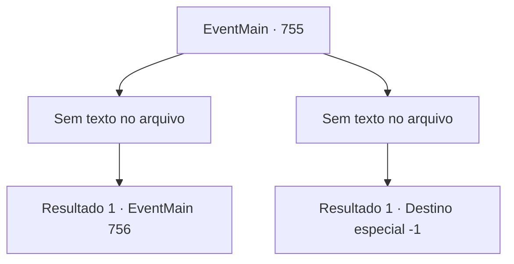

# Eventos principais · 755

[Índice da tabela](index.md) · [Índice geral](../index.md)

ID: `pt:EventMain:755` · Fonte: `EventMain4` · Versão: 1.2.47.

Mapeamento estático dos arquivos; a disponibilidade e a execução dependem do estado da run.

## Texto do evento

*Sem texto no arquivo.*

## Dados de entrada

```json
{
  "id": 755,
  "grade": 1,
  "normalGoal": "",
  "required": ""
}
```

## Mapa das escolhas



## Escolhas e resultados

### Escolha 1

*Sem texto no arquivo; o papel dessa opção depende da interface do jogo.*

Requisitos e outros campos da escolha:

```json
{
  "required": ""
}
```

#### Resultado 1.1

Até mesmo inúmeros ataques dos paladinos não te impedem de queimar sua vingança. Cadáveres ensanguentados se acumulam, e cidadãos nas ruas gritam enquanto fogem. |drawing_publius| 

 "... Por favor, pare com isso. Por que você está fazendo isso?"

 Um homem em uma esplêndida túnica vermelha bordada bloqueia seu caminho naquele momento. Ele é um homem mais velho, com rugas profundas na testa e uma barba que cobre todo o seu rosto inferior. Você tem a intuição de que ele é 'Publius', e segura firmemente a arma. 

 "Diga-me por que você está cometendo esse massacre brutal"

 Publius olha calmamente para você e pergunta em voz baixa.

Continuação registrada: [Evento 756](0756.md) na mesma tabela.

```json
{
  "required": "",
  "chance": "1",
  "nextEvent": 756,
  "type": 2,
  "reward": ""
}
```

### Escolha 2

*Sem texto no arquivo; o papel dessa opção depende da interface do jogo.*

Requisitos e outros campos da escolha:

```json
{
  "required": ""
}
```

#### Resultado 2.1

Os Paladinos que guardam a catedral nem mesmo têm medo da morte. Em vez disso, eles se utilizam como escudos para proteger seus colegas e empunham uma espada contra você enquanto sangram. E nesse ataque desesperado, você acaba caindo.

Continuação registrada: [Destino especial `-1`](../destinos-especiais.md).

```json
{
  "required": "",
  "chance": "1",
  "nextEvent": -1,
  "type": 2,
  "reward": "0_0_-1|0_1_-1|15_5_2|15_5_13|15_5_17"
}
```

## Referências que chegam a este evento

- [Evento 754 · escolha 3 · resultado 1](0754.md#escolha-3)
- [Evento 761 · escolha 1 · resultado 1](0761.md#escolha-1)
