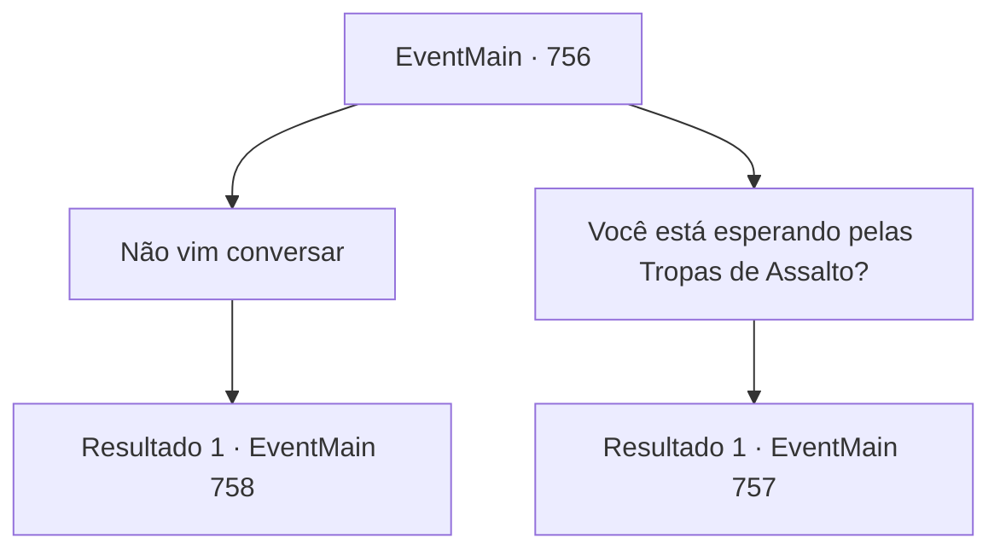

# Eventos principais · 756

[Índice da tabela](index.md) · [Índice geral](../index.md)

ID: `pt:EventMain:756` · Fonte: `EventMain4` · Versão: 1.2.47.

Mapeamento estático dos arquivos; a disponibilidade e a execução dependem do estado da run.

## Texto do evento

*Sem texto no arquivo.*

## Dados de entrada

```json
{
  "id": 756,
  "grade": 1,
  "normalGoal": "",
  "required": ""
}
```

## Mapa das escolhas



## Escolhas e resultados

### Escolha 1

Não vim conversar

Requisitos e outros campos da escolha:

```json
{
  "required": ""
}
```

#### Resultado 1.1

Você se aproxima de Publius, dizendo que não está aqui para conversar. Nesse momento, você ouve a voz de Publius. A voz é poderosa o suficiente para te forçar. <b><link=shake>

 "Ajoelhe-se!"

</link></b> O que Publius diz é um feitiço chamado 'palavra de poder' que força a ação de alguém. Suas pernas estão tentando se ajoelhar independentemente da sua vontade.

Continuação registrada: [Evento 758](0758.md) na mesma tabela.

```json
{
  "required": "",
  "chance": "1",
  "nextEvent": 758,
  "type": 2,
  "reward": ""
}
```

### Escolha 2

Você está esperando pelas Tropas de Assalto?

Requisitos e outros campos da escolha:

```json
{
  "required": "1_14_14"
}
```

#### Resultado 2.1

O que você diz faz com que Publius congele com uma expressão rígida. 

 "Não é possível..."

 Você sorri, segurando uma arma ensanguentada. Você não diz nada, mas é equivalente a uma explicação de que ele estava certo. Então Publius morde o lábio e se aproxima de você. 

 "...Gre, grande Tere! A luz que derrubará o Demônio!"

 Uma lança de luz aparece na mão de Publius e voa em sua direção. Você rebate a lança de luz e corre para tirar o fôlego dele.

Continuação registrada: [Evento 757](0757.md) na mesma tabela.

```json
{
  "required": "",
  "chance": "1",
  "nextEvent": 757,
  "type": 2,
  "reward": "6_0_151",
  "place": 4
}
```

## Referências que chegam a este evento

- [Evento 755 · escolha 1 · resultado 1](0755.md#escolha-1)
