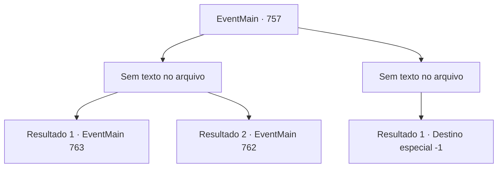

# Eventos principais · 757

[Índice da tabela](index.md) · [Índice geral](../index.md)

ID: `pt:EventMain:757` · Fonte: `EventMain4` · Versão: 1.2.47.

Mapeamento estático dos arquivos; a disponibilidade e a execução dependem do estado da run.

## Texto do evento

*Sem texto no arquivo.*

## Dados de entrada

```json
{
  "id": 757,
  "grade": 1,
  "normalGoal": "",
  "required": ""
}
```

## Mapa das escolhas



## Escolhas e resultados

### Escolha 1

*Sem texto no arquivo; o papel dessa opção depende da interface do jogo.*

Requisitos e outros campos da escolha:

```json
{
  "required": ""
}
```

#### Resultado 1.1


 "Tosse!!...!!"

 Publius, que vomitou sangue, morre enquanto olha para você com olhos doloridos. Então, um sorriso se forma ao redor da sua boca. 

 "Arcebispo...!"

 Devido à morte de Publius, os paladinos ou fogem com medo ou desistem de tudo e se sentam. Você os ignora e dedica a alma de Publius a Kior. Logo você ouve a voz satisfeita de Kior. 

 "Khahaha!!! Ótimo! É excelente! Bem, vou retribuir sua dedicação. Receba minha força. Vou te dar o poder que você nunca experimentou antes."

 E então, com esse poder, Ele te diz para apagar tudo sobre Tere.

Continuação registrada: [Evento 763](0763.md) na mesma tabela.

```json
{
  "required": "5_419_1",
  "chance": "1",
  "nextEvent": 763,
  "type": 2,
  "reward": ""
}
```

#### Resultado 1.2

 

 "Tosse!!...!!"

 Publius, que vomitou sangue, morre enquanto olha para você com olhos doloridos. Então, um sorriso se forma ao redor da sua boca. 

 "Arcebispo...!"

 Devido à morte de Publius, os paladinos ou fogem com medo ou desistem de tudo e se sentam. Você os torna todos iguais a Publius e então olha para a catedral manchada de sangue com uma sensação revigorante. Então, ouço a risada de Kior. 

 "Hahaha! Ótimo trabalho. {1}. Agora dedique suas almas a mim."


Continuação registrada: [Evento 762](0762.md) na mesma tabela.

```json
{
  "required": "18_419_1",
  "chance": "1",
  "nextEvent": 762,
  "type": 2,
  "reward": ""
}
```

### Escolha 2

*Sem texto no arquivo; o papel dessa opção depende da interface do jogo.*

Requisitos e outros campos da escolha:

```json
{
  "required": ""
}
```

#### Resultado 2.1

A luz da mão de Publius atinge você. Você não consegue suportar o choque. Você se ajoelha e vomita sangue. Você tenta se levantar imediatamente, mas nem mesmo tem forças. Publius fica chocado ao olhar para você. 

 "huh...huh... Coloque-o na prisão! Eu o executarei de acordo com a lei de Tere!"

 Por ordem dele, os paladinos ao seu redor arrastam você.

Continuação registrada: [Destino especial `-1`](../destinos-especiais.md).

```json
{
  "required": "",
  "chance": "1",
  "nextEvent": -1,
  "type": 2,
  "reward": "0_0_-1|0_1_-1|15_5_2|15_5_13|15_5_17"
}
```

## Referências que chegam a este evento

- [Evento 756 · escolha 2 · resultado 1](0756.md#escolha-2)
