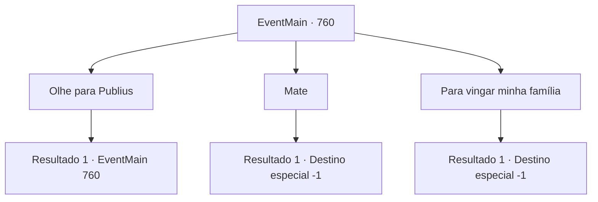

# Eventos principais · 760

[Índice da tabela](index.md) · [Índice geral](../index.md)

ID: `pt:EventMain:760` · Fonte: `EventMain4` · Versão: 1.2.47.

Mapeamento estático dos arquivos; a disponibilidade e a execução dependem do estado da run.

## Texto do evento

*Sem texto no arquivo.*

## Dados de entrada

```json
{
  "id": 760,
  "grade": 1,
  "normalGoal": "",
  "required": ""
}
```

## Mapa das escolhas



## Escolhas e resultados

### Escolha 1

Olhe para Publius

Requisitos e outros campos da escolha:

```json
{
  "required": "5_370_0"
}
```

#### Resultado 1.1

|drawing_publius| 

 "Vocês todos trabalharam duro. Valen, por favor, venha até mim por um momento. E deixe os outros irem descansar por um tempo."

 O Publius que você vê está vestindo uma túnica vermelha sacerdotal bordada com esplendor. Sua testa está profundamente enrugada e sua barba cobre a parte inferior do rosto. E Valen se aproxima de Publius e fica ao seu lado como se o protegesse. Quando os Paladinos saem, Publius abre a boca novamente. 

 "{1}. Você está prestes a morrer. Então tudo que posso dizer é agora."

 Seu olhar determinado olha para você. 

 "Por favor, responda. Por que você fez isso? Por que você teve que matar pessoas?"


Continuação registrada: [Evento 760](0760.md) na mesma tabela.

```json
{
  "required": "",
  "chance": "1",
  "nextEvent": 760,
  "type": 2,
  "reward": "5_370_1"
}
```

### Escolha 2

Mate

Requisitos e outros campos da escolha:

```json
{
  "required": "5_370_1"
}
```

#### Resultado 2.1

Você não responde à pergunta dele até o final. Você está apenas dizendo, 'Mate.' Ao ouvir essas palavras, Publius balança a cabeça e chama os Paladinos em voz alta. 

 "Tudo bem, eu rezo para que sua alma possa ser purificada pela luz de Tere"

 No final dessa frase, você é levado para a prisão pelos Paladinos.

Continuação registrada: [Destino especial `-1`](../destinos-especiais.md).

```json
{
  "required": "",
  "chance": "1",
  "nextEvent": -1,
  "type": 2,
  "reward": "15_5_2|15_5_13|15_5_17"
}
```

### Escolha 3

Para vingar minha família

Requisitos e outros campos da escolha:

```json
{
  "required": "5_370_1"
}
```

#### Resultado 3.1

Com suas palavras, Publius abre a boca com uma expressão surpresa. 

 "Vingança da família...? De jeito nenhum. Eu teria queimado tudo para que isso não acontecesse..."

 Publius olha para você, balançando a cabeça enquanto te encara. Ele te sentencia com uma voz misturada. 

 "Entendo sua situação. Mas mesmo assim, você não pode perdoar o pecado. Leve-o."

 Ao final dessa sentença, você é levado para a prisão pelos Paladinos.

Continuação registrada: [Destino especial `-1`](../destinos-especiais.md).

```json
{
  "required": "",
  "chance": "1",
  "nextEvent": -1,
  "type": 2,
  "reward": "15_5_2|15_5_13|15_5_17"
}
```

## Referências que chegam a este evento

- [Evento 752 · escolha 2 · resultado 1](0752.md#escolha-2)
- [Evento 760 · escolha 1 · resultado 1](0760.md#escolha-1)
