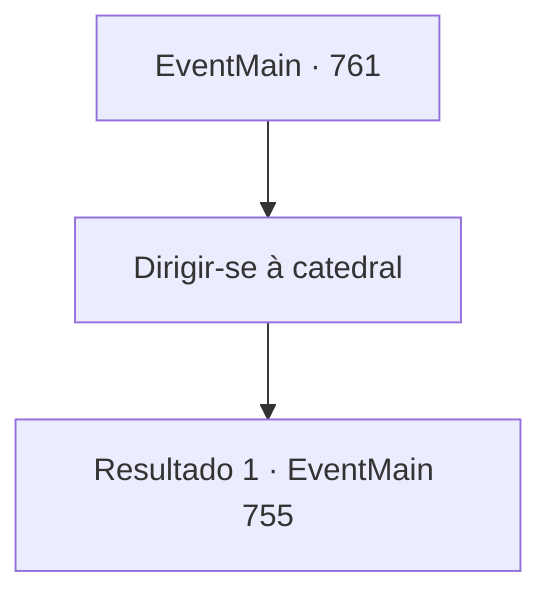

# Eventos principais · 761

[Índice da tabela](index.md) · [Índice geral](../index.md)

ID: `pt:EventMain:761` · Fonte: `EventMain4` · Versão: 1.2.47.

Mapeamento estático dos arquivos; a disponibilidade e a execução dependem do estado da run.

## Texto do evento

*Sem texto no arquivo.*

## Dados de entrada

```json
{
  "id": 761,
  "grade": 1,
  "normalGoal": "",
  "required": ""
}
```

## Mapa das escolhas



## Escolhas e resultados

### Escolha 1

Dirigir-se à catedral

Requisitos e outros campos da escolha:

```json
{
  "required": ""
}
```

#### Resultado 1.1

|drawing_tereCathedral| A catedral, que chegou alguns dias depois, é esplêndida. Todo o edifício é feito de mármore, com uma cúpula azul no topo. Por toda a parede externa há esculturas e pinturas em mosaico em homenagem aos santos de Teretian. 

 "Pare!"

 Ao se aproximar, os paladinos que guardam a catedral bloqueiam você e empurram a espada. Eles olham para você momentaneamente e, de repente, tocam a trombeta. 

 "É o demônio! O demônio está aqui!"

 Ao grito, os paladinos da catedral saem correndo.

Continuação registrada: [Evento 755](0755.md) na mesma tabela.

```json
{
  "required": "",
  "chance": "1",
  "nextEvent": 755,
  "type": 2,
  "reward": "6_0_149",
  "place": 4
}
```

## Referências que chegam a este evento

- [Evento 751 · escolha 2 · resultado 1](0751.md#escolha-2)
