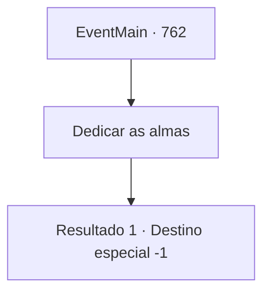

# Eventos principais · 762

[Índice da tabela](index.md) · [Índice geral](../index.md)

ID: `pt:EventMain:762` · Fonte: `EventMain4` · Versão: 1.2.47.

Mapeamento estático dos arquivos; a disponibilidade e a execução dependem do estado da run.

## Texto do evento

*Sem texto no arquivo.*

## Dados de entrada

```json
{
  "id": 762,
  "grade": 1,
  "normalGoal": "",
  "required": ""
}
```

## Mapa das escolhas



## Escolhas e resultados

### Escolha 1

Dedicar as almas

Requisitos e outros campos da escolha:

```json
{
  "required": ""
}
```

#### Resultado 1.1

Como Kior disse, você recupera todas as almas e as dedica a ele. E então sua voz de satisfação é ouvida novamente. 

 "Hahaha. Eu posso sentir a energia. Bem, vamos buscar mais vingança. Apague Teretian do mundo."

 Você concorda com a cabeça e sai dali com suas palavras. Você, a encarnação da vingança, parece um demônio, mas você não se importa. Para destruir completamente Teretian, está tudo bem.

Continuação registrada: [Destino especial `-1`](../destinos-especiais.md).

```json
{
  "required": "",
  "chance": "1",
  "nextEvent": -1,
  "type": 2,
  "reward": "15_5_5|15_5_8|15_5_14|15_5_27"
}
```

## Referências que chegam a este evento

- [Evento 757 · escolha 1 · resultado 2](0757.md#escolha-1)
- [Evento 758 · escolha 1 · resultado 2](0758.md#escolha-1)
- [Evento 758 · escolha 1 · resultado 5](0758.md#escolha-1)
- [Evento 758 · escolha 2 · resultado 2](0758.md#escolha-2)
- [Evento 759 · escolha 1 · resultado 2](0759.md#escolha-1)
- [Evento 759 · escolha 1 · resultado 5](0759.md#escolha-1)
- [Evento 759 · escolha 2 · resultado 2](0759.md#escolha-2)
