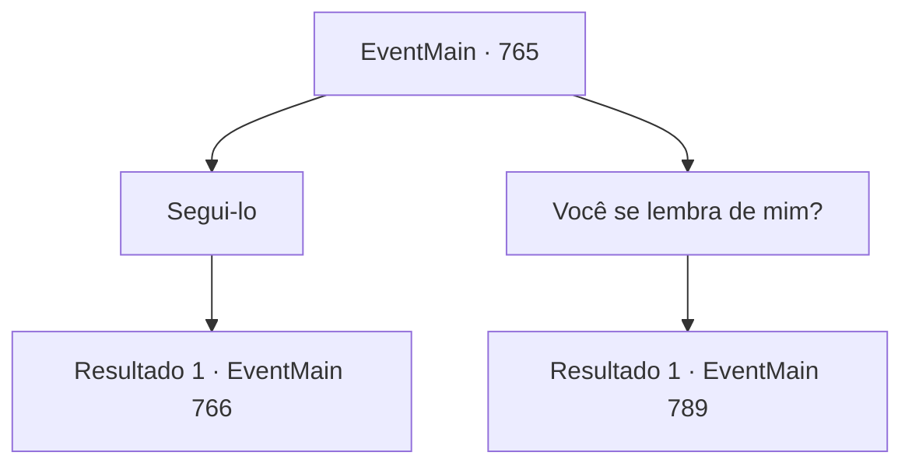

# Eventos principais · 765

[Índice da tabela](index.md) · [Índice geral](../index.md)

ID: `pt:EventMain:765` · Fonte: `EventMain4` · Versão: 1.2.47.

Mapeamento estático dos arquivos; a disponibilidade e a execução dependem do estado da run.

## Texto do evento

Você olhou para a carta da pomba branca com o coração acelerado. A mensagem de Danica indicava que a hora da batalha contra Kior estava se aproximando. Sem perder tempo, você preparou tudo o que precisava e seguiu em direção à grandiosa Catedral de Yerut. |drawing_tereCathedral| Alguns dias depois, você chegou à imponente estrutura da catedral. Milhares de cavaleiros de Tere, com suas armaduras marcadas com o símbolo da Igreja, estavam espalhados e pareciam estar se preparando para algo grande. A atmosfera estava tensa e cheia de atividades, como se algo importante estivesse prestes a acontecer.  Quando você subiu as escadas na entrada da catedral, um cavaleiro bloqueou seu caminho. Ele estava coberto por escamas douradas e tinha olhos verticais, como os de um réptil. Você não precisou de muito para reconhecer quem ele era.  Era Onil, um cavaleiro homem-lagarto, e o mesmo que havia condenado sua família à fogueira no passado.  

 "Ouvi sobre você e Danica, e sobre o que o Arcebispo disse. Vou guiá-lo até eles."

  Ele falou com um tom seco e impessoal, então virou-se e entrou na catedral, esperando que você o seguisse.

## Dados de entrada

```json
{
  "id": 765,
  "grade": 1,
  "normalGoal": "",
  "required": "1_2_100|13_4_20"
}
```

## Mapa das escolhas



## Escolhas e resultados

### Escolha 1

Segui-lo

Requisitos e outros campos da escolha:

```json
{
  "required": ""
}
```

#### Resultado 1.1

Você segue Onil até a catedral. Caminhando pelo chão de mármore branco, você vê um grande quadrado atrás da catedral. Na praça, há um enorme círculo mágico gravado com dezenas de milhares de runas, e várias ferramentas magias estão instaladas ao redor do círculo mágico. 

 "{1} está aqui, o arcebispo"

 Publius está rezando respeitosamente no centro da praça. Ao ouvir as palavras de Onil, Publius se vira e olha para você. 

 "Está na hora, {1}. Você está pronto?"


Continuação registrada: [Evento 766](0766.md) na mesma tabela.

```json
{
  "required": "",
  "chance": "1",
  "nextEvent": 766,
  "type": 2,
  "reward": ""
}
```

### Escolha 2

Você se lembra de mim?

Requisitos e outros campos da escolha:

```json
{
  "required": "5_420_0"
}
```

#### Resultado 2.1

Onil hesita em dizer isso. 

 "...Claro. Ouvi isso da Danica. Você quer que eu peça desculpas?"

 Onil continua com uma voz confiante. 

 "Deve ter sido uma tragédia para você. Mas foi pela justiça. Sou servo da Tere. Não me arrependo e farei novamente se a mesma coisa acontecer."

 Ele fala com uma expressão calma. 

 "Entendo que você está me culpando. No entanto, precisamos enterrar o passado e unir forças para nossos objetivos."


Continuação registrada: [Evento 789](0789.md) na mesma tabela.

```json
{
  "required": "",
  "chance": "1",
  "nextEvent": 789,
  "type": 2,
  "reward": "5_420_1"
}
```

## Referências que chegam a este evento

Nenhum `nextEvent` positivo da mesma tabela aponta para este nó. Isso não prova que seja inacessível: sorteio e estado de história podem selecioná-lo.

