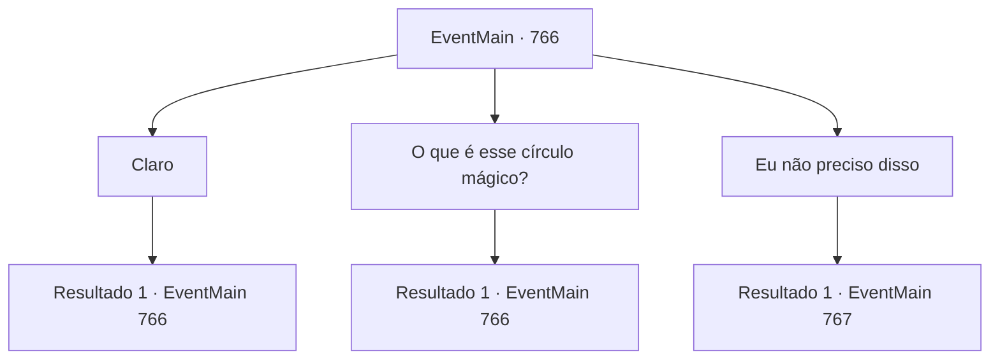

# Eventos principais · 766

[Índice da tabela](index.md) · [Índice geral](../index.md)

ID: `pt:EventMain:766` · Fonte: `EventMain4` · Versão: 1.2.47.

Mapeamento estático dos arquivos; a disponibilidade e a execução dependem do estado da run.

## Texto do evento

*Sem texto no arquivo.*

## Dados de entrada

```json
{
  "id": 766,
  "grade": 1,
  "normalGoal": "",
  "required": ""
}
```

## Mapa das escolhas



## Escolhas e resultados

### Escolha 1

Claro

Requisitos e outros campos da escolha:

```json
{
  "required": "5_421_0"
}
```

#### Resultado 1.1

Você responde a pergunta, é claro. E então Publius diz, olhando para o gin mágico esculpido na praça. 

 "Que alívio. Estamos todos preparados aqui também. Amanhã de manhã, trarei Kior aqui, para a catedral."

 Publius explica que precisou de três meses para se preparar para isso. 

 "Então... Se você tiver alguma dúvida sobre o plano, eu explicarei para você."

 Seus olhos estão em você novamente.

Continuação registrada: [Evento 766](0766.md) na mesma tabela.

```json
{
  "required": "",
  "chance": "1",
  "nextEvent": 766,
  "type": 2,
  "reward": "5_421_1"
}
```

### Escolha 2

O que é esse círculo mágico?

Requisitos e outros campos da escolha:

```json
{
  "required": "5_421_1"
}
```

#### Resultado 2.1

Em resposta à sua pergunta, Publius limpa a garganta momentaneamente e explica com uma voz calma. 

 "Antes de falar sobre isso, há algo que você deve saber. Mesmo que o demônio morra no mundo material, ele retorna ao inferno e volta à vida."

 Publius franze a testa, dizendo que o poder do demônio pode ser mais forte do que antes, embora leve tempo para reviver. 

 "Para evitar a ressurreição do demônio, não temos escolha a não ser matá-lo no inferno. Mas o poder do demônio fica mais forte no inferno, então ir para lá é imprudente."

 Publius continua a explicar, batendo no círculo mágico desenhado no chão. 

 "É por isso que desenhamos este círculo mágico."

 O círculo mágico tem dois efeitos. Um é trazer Kior para o mundo material, O outro é manter Kior nesta dimensão para que ele não possa retornar ao inferno mesmo depois de morrer. Após a explicação, Publius olha para você, perguntando se você tem mais alguma pergunta.

Continuação registrada: [Evento 766](0766.md) na mesma tabela.

```json
{
  "required": "",
  "chance": "1",
  "nextEvent": 766,
  "type": 2,
  "reward": "5_421_2"
}
```

### Escolha 3

Eu não preciso disso

Requisitos e outros campos da escolha:

```json
{
  "required": "18_421_0"
}
```

#### Resultado 3.1

Você decide não perguntar sobre o plano. Publius acena com a cabeça e chama o atendente para perguntar por você. 

 "Você tem um alojamento para descansar. Descanse bem hoje e nos vemos amanhã. Onil, por favor, fale comigo por um momento."

 Com isso, Onil se dirige a Publius e você segue o atendente para fora da catedral. O alojamento em que você chega logo em seguida é um hotel de luxo perto da catedral. Seu quarto é espaçoso e bem cuidado. Você se deita em uma cama arrumada e fofa e pensa no que fazer. Ainda é dia claro, então há tempo antes do próximo dia.

Continuação registrada: [Evento 767](0767.md) na mesma tabela.

```json
{
  "required": "",
  "chance": "1",
  "nextEvent": 767,
  "type": 2,
  "reward": "5_421_2"
}
```

## Referências que chegam a este evento

- [Evento 765 · escolha 1 · resultado 1](0765.md#escolha-1)
- [Evento 766 · escolha 1 · resultado 1](0766.md#escolha-1)
- [Evento 766 · escolha 2 · resultado 1](0766.md#escolha-2)
- [Evento 789 · escolha 1 · resultado 1](0789.md#escolha-1)
- [Evento 789 · escolha 1 · resultado 2](0789.md#escolha-1)
- [Evento 789 · escolha 2 · resultado 1](0789.md#escolha-2)
