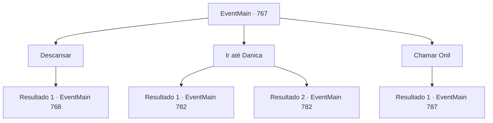

# Eventos principais · 767

[Índice da tabela](index.md) · [Índice geral](../index.md)

ID: `pt:EventMain:767` · Fonte: `EventMain4` · Versão: 1.2.47.

Mapeamento estático dos arquivos; a disponibilidade e a execução dependem do estado da run.

## Texto do evento

*Sem texto no arquivo.*

## Dados de entrada

```json
{
  "id": 767,
  "grade": 1,
  "normalGoal": "",
  "required": ""
}
```

## Mapa das escolhas



## Escolhas e resultados

### Escolha 1

Descansar

Requisitos e outros campos da escolha:

```json
{
  "required": ""
}
```

#### Resultado 1.1

Você descansa na estalagem. Como o alojamento é uma estalagem de luxo, você passa uma noite mais confortável do que nos outros dias.

 No dia seguinte, você segue para a catedral na hora certa. Ao entrar na praça atrás da catedral, há muitos paladinos fortemente armados se preparando para a batalha. Publius aumenta a moral com seus discursos e, eventualmente, Danica aparece e fica no centro do círculo mágico. 

 "Um grande homem! Os Cordeiros se reúnem para rezar! Por favor, nos dê um caminho para nos conectarmos com o mundo."

 Enquanto Danica recita um feitiço, a luz se espalha a partir do círculo mágico. Caracteres rúnicos esculpidos no chão surgem no ar e giram ao redor da catedral, e uma mana poderosa varre como uma rajada de vento. <color=red> 

 "Kior! Por favor, mostre-me o seu mundo."

</color> Então, o mundo vira de cabeça para baixo em sua última palavra.

Continuação registrada: [Evento 768](0768.md) na mesma tabela.

```json
{
  "required": "",
  "chance": "1",
  "nextEvent": 768,
  "type": 2,
  "reward": "0_0_1|0_1_1"
}
```

### Escolha 2

Ir até Danica

Requisitos e outros campos da escolha:

```json
{
  "required": "5_422_0"
}
```

#### Resultado 2.1

Você sai do alojamento e vai até Danica. Ela estava fazendo trabalho missionário na rua perto da catedral. Quando ela te viu, ela rapidamente terminou o trabalho missionário. Ela se aproxima de você e diz com um sorriso. 

 "Faz um tempo. {1}. Como você tem estado?"

 Danica fala animadamente, trazendo histórias acumuladas por três meses. O trabalho de ritual para trazer Kior para o mundo material. O que ela ouviu sobre você enquanto fazia trabalho missionário. Ela faz muito barulho e sorri como sempre. Mas você percebe que sente uma sensação desconhecida de estranheza nela.

Continuação registrada: [Evento 782](0782.md) na mesma tabela.

```json
{
  "required": "1_14_15",
  "chance": "1",
  "nextEvent": 782,
  "type": 2,
  "reward": "5_422_1"
}
```

#### Resultado 2.2

Você sai do alojamento e vai até Danica. Ela estava fazendo trabalho missionário na rua perto da catedral. Quando ela te viu, ela rapidamente terminou o trabalho missionário. Ela se aproxima de você e diz com um sorriso. 

 "Faz um tempo. {1}. Como você tem estado?"

 Danica fala animadamente, trazendo histórias acumuladas por três meses. O trabalho de ritual para trazer Kior para o mundo material. O que ela ouviu sobre você enquanto fazia trabalho missionário. Ela faz muito barulho e sorri como sempre.

Continuação registrada: [Evento 782](0782.md) na mesma tabela.

```json
{
  "required": "2_14_15",
  "chance": "1",
  "nextEvent": 782,
  "type": 2,
  "reward": ""
}
```

### Escolha 3

Chamar Onil

Requisitos e outros campos da escolha:

```json
{
  "required": "5_420_0"
}
```

#### Resultado 3.1

Você chama Onil pelo anfitrião da acomodação. 

 É meia-noite quando Onil te visita. Ele se aproxima de você e pergunta em voz baixa. 

 "Desculpe por estar atrasado. O Arcebispo me fez fazer algo. Então, qual é o seu negócio comigo?"


Continuação registrada: [Evento 787](0787.md) na mesma tabela.

```json
{
  "required": "",
  "chance": "1",
  "nextEvent": 787,
  "type": 2,
  "reward": ""
}
```

## Referências que chegam a este evento

- [Evento 766 · escolha 3 · resultado 1](0766.md#escolha-3)
