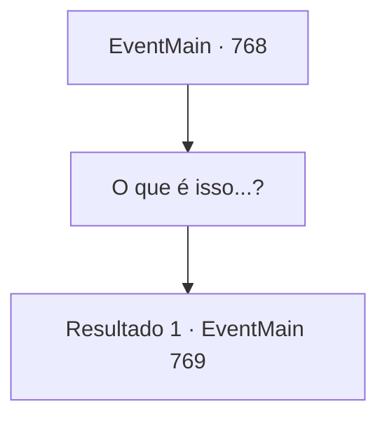

# Eventos principais · 768

[Índice da tabela](index.md) · [Índice geral](../index.md)

ID: `pt:EventMain:768` · Fonte: `EventMain4` · Versão: 1.2.47.

Mapeamento estático dos arquivos; a disponibilidade e a execução dependem do estado da run.

## Texto do evento

*Sem texto no arquivo.*

## Dados de entrada

```json
{
  "id": 768,
  "grade": 1,
  "normalGoal": "",
  "required": ""
}
```

## Mapa das escolhas



## Escolhas e resultados

### Escolha 1

O que é isso...?

Requisitos e outros campos da escolha:

```json
{
  "required": ""
}
```

#### Resultado 1.1

O lugar que você vê é um palácio enorme. É pelo menos cinco vezes maior e mais alto do que a Catedral de Teretian. Não apenas a largura e altura do prédio, mas tudo nele é enorme. E no trono no final do salão está Kior. Ele é o mesmo que quando você o conheceu pela primeira vez, mas ele é enorme. Seus ossos da canela são mais altos do que você. Seus olhos vermelhos como sangue olham para baixo para os paladinos. |drawing_sittingKior| 

 "É ridículo. Não é o Tere. É o mortal do Tere. Você pode me derrubar?"

 Sua voz ecoa alto, mesmo em seu tom baixo. Kior senta-se no trono e fala suavemente com uma expressão relaxada. 

 "Mate-os. Danica"

 Quando suas ordens são dadas, Danica corre em sua direção. A adaga em sua mão brilha nitidamente.

Continuação registrada: [Evento 769](0769.md) na mesma tabela.

```json
{
  "required": "",
  "chance": "1",
  "nextEvent": 769,
  "type": 2,
  "reward": ""
}
```

## Referências que chegam a este evento

- [Evento 767 · escolha 1 · resultado 1](0767.md#escolha-1)
- [Evento 782 · escolha 1 · resultado 2](0782.md#escolha-1)
- [Evento 782 · escolha 3 · resultado 1](0782.md#escolha-3)
- [Evento 788 · escolha 1 · resultado 1](0788.md#escolha-1)
- [Evento 788 · escolha 1 · resultado 2](0788.md#escolha-1)
- [Evento 788 · escolha 2 · resultado 1](0788.md#escolha-2)
