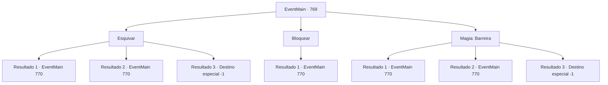

# Eventos principais · 769

[Índice da tabela](index.md) · [Índice geral](../index.md)

ID: `pt:EventMain:769` · Fonte: `EventMain4` · Versão: 1.2.47.

Mapeamento estático dos arquivos; a disponibilidade e a execução dependem do estado da run.

## Texto do evento

*Sem texto no arquivo.*

## Dados de entrada

```json
{
  "id": 769,
  "grade": 1,
  "normalGoal": "",
  "required": ""
}
```

## Mapa das escolhas



## Escolhas e resultados

### Escolha 1

Esquivar

Requisitos e outros campos da escolha:

```json
{
  "required": ""
}
```

#### Resultado 1.1

Você rapidamente se desvia e evita a adaga. Olhando para isso, Kior ri. 

 "Hahaha. Eu não esperava morrer com isso. E então, o que você acha disso?"

 Enquanto Kior balança o dedo, muitos demônios aparecem na escuridão. Os demônios cercam os Paladinos e os atacam, e o palácio rapidamente se torna um campo de batalha. Ficando parado em choque, Publius finalmente recupera os sentidos e grita urgentemente. 

 "Da... Danica! Por que...!"

 Danica não responde à sua pergunta. Ela fica ao lado de Kior e observa a luta desesperada de seus antigos colegas. Kior grita, agitando uma taça de vinho em sua mão. 

 "Balor! Dê uma morte dolorosa ao ser insignificante que traiu este corpo."

 Balor, com chifres enormes, corre em sua direção.

Continuação registrada: [Evento 770](0770.md) na mesma tabela.

```json
{
  "required": "",
  "chance": "1|0_6_1",
  "nextEvent": 770,
  "type": 0,
  "reward": "6_0_69",
  "place": 7
}
```

#### Resultado 1.2

Tentas evitar o punhal, mas eventualmente permites um ataque. No entanto, como não é um ferimento fatal, afastas-te de Danica e preparas-te novamente. Ao ver isso, Kior ri. 

 "Hahaha. Não esperava morrer com isto. Então, e agora?"

 Enquanto Kior balança o dedo, muitos demônios aparecem na escuridão. Os demônios cercam os Paladinos e atacam-nos, e o palácio rapidamente se torna um campo de batalha. Parado em choque, Publius finalmente recupera os sentidos e grita urgentemente. 

 "Da... Danica! Porquê...!"

 Danica não responde à sua pergunta. Ela fica ao lado de Kior e observa a luta desesperada de seus antigos colegas. Kior grita, agitando um copo de vinho em sua mão. 

 "Balor! Dê uma morte dolorosa ao ser insignificante que traiu este corpo."

 Balor, com chifres enormes, corre em sua direção.

Continuação registrada: [Evento 770](0770.md) na mesma tabela.

```json
{
  "required": "1_0_2",
  "chance": "16",
  "nextEvent": 770,
  "type": 1,
  "reward": "0_0_-1|6_0_69",
  "place": 7
}
```

#### Resultado 1.3

Tentas evitar a adaga, mas eventualmente permites um ataque. Um golpe fatal perfura o teu coração, e o sangue jorra. Ao olhar para isso, Kior explode numa risada agradável. 

 "Hahahahaha! Sou tão patético. {1}."

 Em breve, um sorriso malicioso se forma ao redor de sua boca. 

 "Não penses que acaba com a morte {1}. A morte não pode te libertar da dor."

 Fechas os olhos e sentes o fim se aproximando. Ficando parado em choque, Publius finalmente recupera os sentidos e grita urgentemente. 

 "Da... Danica! Porquê...!"

 Um sono profundo torna impossível pensar no que as palavras de Kior significam. A tua consciência afunda na escuridão densa.

Continuação registrada: [Destino especial `-1`](../destinos-especiais.md).

```json
{
  "required": "2_0_2",
  "chance": "16",
  "nextEvent": -1,
  "type": 1,
  "reward": "0_0_-1|15_5_1|15_5_14|15_5_33"
}
```

### Escolha 2

Bloquear

Requisitos e outros campos da escolha:

```json
{
  "required": "20_9_1"
}
```

#### Resultado 2.1

Você bloqueia rapidamente o punhal e empurra Danica para longe. Ao ver isso, Kior ri. 

 "Hahaha. Eu não esperava morrer com isso. Então, e agora?"

 Enquanto Kior balança o dedo, muitos demônios aparecem na escuridão. Os demônios cercam os Paladinos e os atacam, e o palácio rapidamente se torna um campo de batalha. Ficando parado em choque, Publius finalmente recupera os sentidos e grita urgentemente. 

 "Da... Danica! Por que...!"

 Danica não responde à sua pergunta. Ela fica ao lado de Kior e observa a luta desesperada de seus antigos colegas. Kior grita, agitando uma taça de vinho em sua mão. 

 "Balor! Dê uma morte dolorosa ao ser insignificante que traiu este corpo."

 Balor, com chifres enormes, corre em sua direção.

Continuação registrada: [Evento 770](0770.md) na mesma tabela.

```json
{
  "required": "",
  "chance": "1",
  "nextEvent": 770,
  "type": 2,
  "reward": "6_0_69",
  "place": 7
}
```

### Escolha 3

Magia: Barreira

Requisitos e outros campos da escolha:

```json
{
  "required": "20_0_2|1_1_2"
}
```

#### Resultado 3.1

Você bloqueia o punhal com uma Barreira. Ao ver isso, Kior ri. 

 "Hahaha. Eu não esperava morrer com isso. E então, o que você acha disso?"

 Enquanto Kior balança o dedo, muitos demônios aparecem na escuridão. Os demônios cercam os Paladinos e os atacam, e o palácio rapidamente se torna um campo de batalha. Ficando parado em choque, Publius finalmente recupera os sentidos e grita urgentemente. 

 "Da... Danica! Por que...!"

 Danica não responde à sua pergunta. Ela fica ao lado de Kior e observa a luta desesperada de seus antigos colegas. Kior grita, agitando uma taça de vinho em sua mão. 

 "Balor! Dê uma morte dolorosa ao ser insignificante que traiu este corpo."

 Balor, com chifres enormes, corre em sua direção.

Continuação registrada: [Evento 770](0770.md) na mesma tabela.

```json
{
  "required": "",
  "chance": "1|0_7_1|0_12_1",
  "nextEvent": 770,
  "type": 0,
  "reward": "6_0_69|0_1_-1",
  "place": 7
}
```

#### Resultado 3.2

Você tenta conjurar Barreira, mas eventualmente, permite um ataque. No entanto, como não é um ferimento fatal, você se afasta de Danica e se prepara novamente. Ao ver isso, Kior ri. 

 "Hahaha. Eu não esperava morrer com isso. E então, o que você acha disso?"

 Enquanto Kior balança o dedo, muitos demônios aparecem na escuridão. Os demônios cercam os Paladinos e os atacam, e o palácio rapidamente se torna um campo de batalha. Ficando parado em choque, Publius finalmente recupera os sentidos e grita urgentemente. 

 "Da... Danica! Por que...!"

 Danica não responde à sua pergunta. Ela fica ao lado de Kior e observa a luta desesperada de seus antigos colegas. Kior grita, agitando uma taça de vinho em sua mão. 

 "Balor! Dê uma morte dolorosa ao ser insignificante que traiu este corpo."

 Balor, com chifres enormes, corre em sua direção.

Continuação registrada: [Evento 770](0770.md) na mesma tabela.

```json
{
  "required": "1_0_2",
  "chance": "16",
  "nextEvent": 770,
  "type": 1,
  "reward": "0_0_-1|6_0_69|0_1_-1",
  "place": 7
}
```

#### Resultado 3.3

Você tenta usar a Barreira, mas eventualmente permite um ataque. Um golpe fatal perfura seu coração, e o sangue jorra. Olhando para isso, Kior explode em uma risada agradável. 

 "Hahahahaha! Sou tão patético. {1}."

 Logo um sorriso malicioso se forma ao redor de sua boca. 

 "Não pense que acaba com a morte {1}. A morte não pode te libertar da dor."

 Você fecha os olhos e sente o fim se aproximando. Ficando parado em choque, Publius finalmente recobra os sentidos e grita urgentemente. 

 "Da... Danica! Por que...!"

 Um sono profundo torna impossível pensar no significado das palavras de Kior. Sua consciência afunda na escuridão densa.

Continuação registrada: [Destino especial `-1`](../destinos-especiais.md).

```json
{
  "required": "2_0_2",
  "chance": "16",
  "nextEvent": -1,
  "type": 1,
  "reward": "0_0_-1|15_5_1|15_5_14|15_5_33|0_1_-1"
}
```

## Referências que chegam a este evento

- [Evento 768 · escolha 1 · resultado 1](0768.md#escolha-1)
