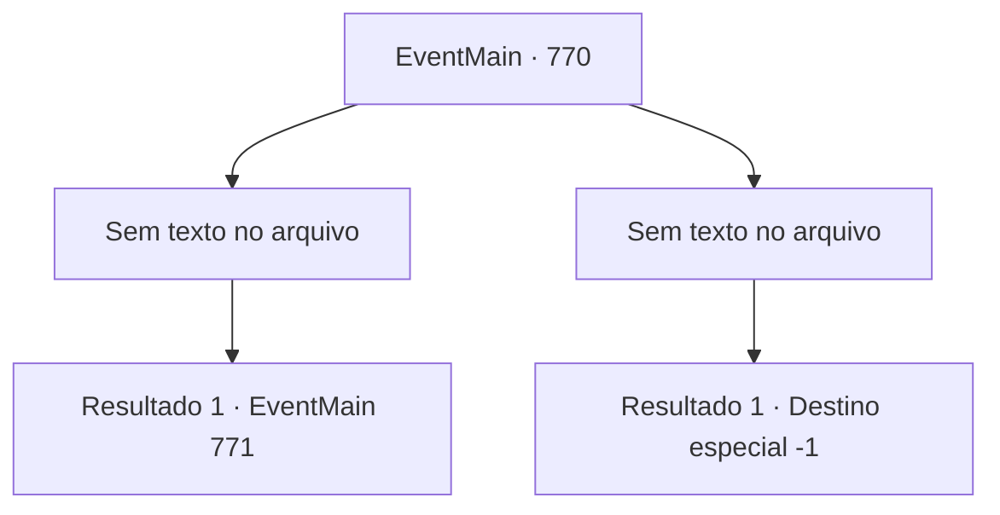

# Eventos principais · 770

[Índice da tabela](index.md) · [Índice geral](../index.md)

ID: `pt:EventMain:770` · Fonte: `EventMain4` · Versão: 1.2.47.

Mapeamento estático dos arquivos; a disponibilidade e a execução dependem do estado da run.

## Texto do evento

*Sem texto no arquivo.*

## Dados de entrada

```json
{
  "id": 770,
  "grade": 1,
  "normalGoal": "",
  "required": ""
}
```

## Mapa das escolhas



## Escolhas e resultados

### Escolha 1

*Sem texto no arquivo; o papel dessa opção depende da interface do jogo.*

Requisitos e outros campos da escolha:

```json
{
  "required": ""
}
```

#### Resultado 1.1

Você derruba Balor e olha ao redor. Os Paladinos estão lutando de volta ocasionalmente, mas o dano é ainda mais significativo, talvez por causa do cerco. Publius começa a recitar um feitiço com as mãos juntas. 

 "Grande Tere! O servo de Tere sacrifica a vida. Por favor, nos dê um milagre sagrado."

 Uma aura dourada emana de seu corpo em oração. E essas auras sobem ao ar, distorcendo o espaço e abrindo uma fenda na dimensão. Na fenda dimensional aberta, você vê a Catedral de Yerut. 

 "Huh..huh...!"

 O corpo de Publius, que recita o feitiço, começa a secar. Está consumindo sua própria vitalidade. Quando Valen vê isso, ela grita. 

 "O arcebispo fez um milagre! Todos, fiquem ao lado do arcebispo e recuem!"

 Em seu grito, os Paladinos protegem Publius e lentamente se dirigem à fenda da dimensão. 

 "Matem aquele homem mais velho!"

 Com o grito feroz de Kior, os demônios se lançam sobre Publius.

Continuação registrada: [Evento 771](0771.md) na mesma tabela.

```json
{
  "required": "",
  "chance": "1",
  "nextEvent": 771,
  "type": 2,
  "reward": ""
}
```

### Escolha 2

*Sem texto no arquivo; o papel dessa opção depende da interface do jogo.*

Requisitos e outros campos da escolha:

```json
{
  "required": ""
}
```

#### Resultado 2.1

Balor agarra você e levanta. E abre essa boca grande e te devora por completo.

 <color=red>'Crack!'</color>

 Você, esmagado na boca de Balor, morre como você é.

Continuação registrada: [Destino especial `-1`](../destinos-especiais.md).

```json
{
  "required": "",
  "chance": "1",
  "nextEvent": -1,
  "type": 2,
  "reward": "0_0_-1|0_1_-1|15_5_1|15_5_14|15_5_33"
}
```

## Referências que chegam a este evento

- [Evento 769 · escolha 1 · resultado 1](0769.md#escolha-1)
- [Evento 769 · escolha 1 · resultado 2](0769.md#escolha-1)
- [Evento 769 · escolha 2 · resultado 1](0769.md#escolha-2)
- [Evento 769 · escolha 3 · resultado 1](0769.md#escolha-3)
- [Evento 769 · escolha 3 · resultado 2](0769.md#escolha-3)
