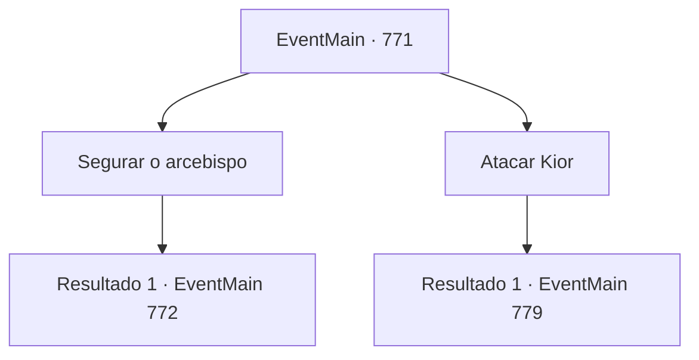

# Eventos principais · 771

[Índice da tabela](index.md) · [Índice geral](../index.md)

ID: `pt:EventMain:771` · Fonte: `EventMain4` · Versão: 1.2.47.

Mapeamento estático dos arquivos; a disponibilidade e a execução dependem do estado da run.

## Texto do evento

*Sem texto no arquivo.*

## Dados de entrada

```json
{
  "id": 771,
  "grade": 1,
  "normalGoal": "",
  "required": ""
}
```

## Mapa das escolhas



## Escolhas e resultados

### Escolha 1

Segurar o arcebispo

Requisitos e outros campos da escolha:

```json
{
  "required": ""
}
```

#### Resultado 1.1

Você derrotou os demônios que avançam na frente de Publius. Mas o número de demônios ao seu redor é muito maior do que você, e os Paladinos o derrubaram. 

 "Mate todos eles! Mate todos eles e dedique-os a mim!"

 Você range os dentes enquanto suporta o ataque crescente dos demônios.

Continuação registrada: [Evento 772](0772.md) na mesma tabela.

```json
{
  "required": "",
  "chance": "1",
  "nextEvent": 772,
  "type": 2,
  "reward": "6_0_154",
  "place": 7
}
```

### Escolha 2

Atacar Kior

Requisitos e outros campos da escolha:

```json
{
  "required": ""
}
```

#### Resultado 2.1

Você aproveita o ataque a Publius e pula em cima de Kior. Agora que o Ofensiva do Demônio está focada em Publius, Danica é a única ao redor dele. Você rapidamente nocauteia Danica e balança sua arma em direção a Kior. Então Kior ergue seu corpo enorme e responde com uma espada contendo uma aura negra. 

 "Khaha! Você está tentando me atacar? Essa é uma escolha estúpida! {1}!"

 A espada atinge, e um som pesado ressoa.

Continuação registrada: [Evento 779](0779.md) na mesma tabela.

```json
{
  "required": "",
  "chance": "1",
  "nextEvent": 779,
  "type": 2,
  "reward": "6_0_155",
  "place": 7
}
```

## Referências que chegam a este evento

- [Evento 770 · escolha 1 · resultado 1](0770.md#escolha-1)
