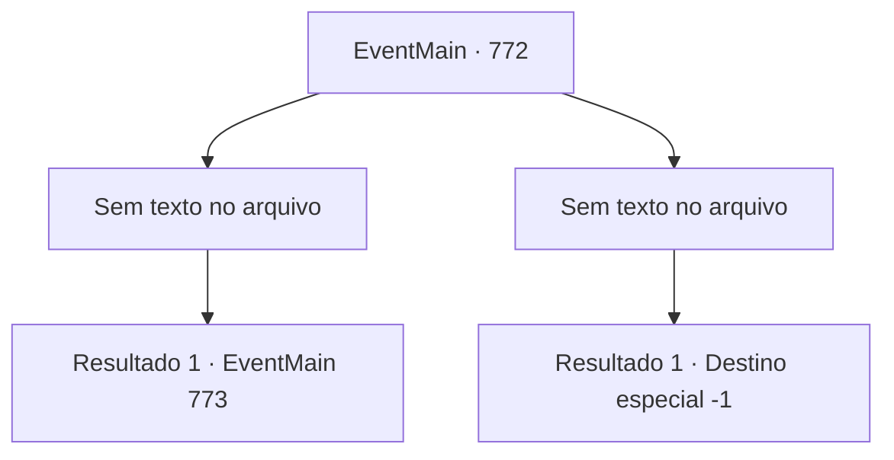

# Eventos principais · 772

[Índice da tabela](index.md) · [Índice geral](../index.md)

ID: `pt:EventMain:772` · Fonte: `EventMain4` · Versão: 1.2.47.

Mapeamento estático dos arquivos; a disponibilidade e a execução dependem do estado da run.

## Texto do evento

*Sem texto no arquivo.*

## Dados de entrada

```json
{
  "id": 772,
  "grade": 1,
  "normalGoal": "",
  "required": ""
}
```

## Mapa das escolhas



## Escolhas e resultados

### Escolha 1

*Sem texto no arquivo; o papel dessa opção depende da interface do jogo.*

Requisitos e outros campos da escolha:

```json
{
  "required": ""
}
```

#### Resultado 1.1

Quando você está no meio de uma luta, há uma luz brilhante vindo de trás. O milagre de Publius está completo. A lacuna na dimensão está completamente ampliada e há um brilho quente saindo. A luz branca envolve os paladinos e os puxa para o portal finalizado. Em troca, Publius se transforma em uma estátua branca no local. Olhando para isso, Kior chuta a língua. 

 "Ele terminou?"

 Ele olha para o portal e depois olha para você. 

 "{1}... Você trabalhou duro. Foi um prazer ver suas habilidades. Khahaha!"

 O riso alegre e zombeteiro balança sua cabeça.

Continuação registrada: [Evento 773](0773.md) na mesma tabela.

```json
{
  "required": "",
  "chance": "1",
  "nextEvent": 773,
  "type": 2,
  "reward": ""
}
```

### Escolha 2

*Sem texto no arquivo; o papel dessa opção depende da interface do jogo.*

Requisitos e outros campos da escolha:

```json
{
  "required": ""
}
```

#### Resultado 2.1

Os demônios ordenados por Kior te despedaçam. Seu corpo é dividido em braços, cabeças, pernas e tronco, tornando-se um brinquedo para os demônios.

Continuação registrada: [Destino especial `-1`](../destinos-especiais.md).

```json
{
  "required": "",
  "chance": "1",
  "nextEvent": -1,
  "type": 2,
  "reward": "0_0_-1|0_1_-1|15_5_1|15_5_14|15_5_33"
}
```

## Referências que chegam a este evento

- [Evento 771 · escolha 1 · resultado 1](0771.md#escolha-1)
