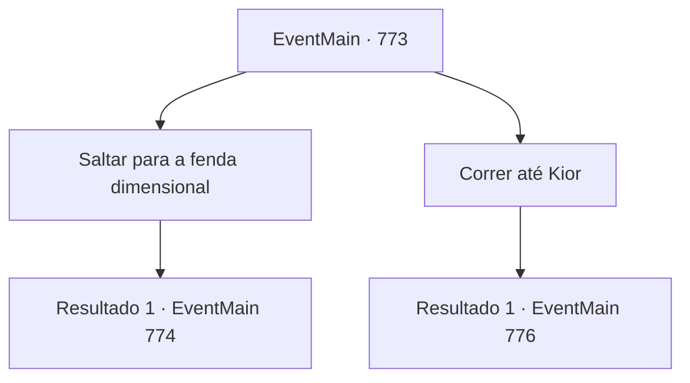

# Eventos principais · 773

[Índice da tabela](index.md) · [Índice geral](../index.md)

ID: `pt:EventMain:773` · Fonte: `EventMain4` · Versão: 1.2.47.

Mapeamento estático dos arquivos; a disponibilidade e a execução dependem do estado da run.

## Texto do evento

*Sem texto no arquivo.*

## Dados de entrada

```json
{
  "id": 773,
  "grade": 1,
  "normalGoal": "",
  "required": ""
}
```

## Mapa das escolhas



## Escolhas e resultados

### Escolha 1

Saltar para a fenda dimensional

Requisitos e outros campos da escolha:

```json
{
  "required": ""
}
```

#### Resultado 1.1

Você pula através de uma fenda na dimensão. Logo depois, uma luz quente te envolve.

 Quando você abre os olhos, vê a Catedral de Yerut. Mas o lugar chamado Santuário de Tere, parece um campo de batalha. A maioria dos Paladinos está caída com ferimentos, e aqueles que estão intactos estão vagando em busca de tratamento. Você suspira e se encosta contra a coluna branca. Mas foi então. Viyork aponta para você e explode de raiva. 

 "Tudo isso é por causa de {1}! {1} conspirou com Danica e nos traiu!!"

 Os olhos de todos na catedral se voltam para você ao grito de Viyork. Eles têm dúvidas em seus olhos, mas não parecem ter certeza.

Continuação registrada: [Evento 774](0774.md) na mesma tabela.

```json
{
  "required": "",
  "chance": "1",
  "nextEvent": 774,
  "type": 2,
  "reward": ""
}
```

### Escolha 2

Correr até Kior

Requisitos e outros campos da escolha:

```json
{
  "required": ""
}
```

#### Resultado 2.1

Você não consegue conter sua raiva e corre em direção a Kior. Kior se levanta do trono, olhando para você, e joga o copo de vinho que segurava. 

 "Khaha! Você é tão estúpido! Ótimo! {1} Se você quer morrer pelas minhas mãos, eu vou lidar com você o quanto eu quiser!"

 Kior pega a espada pendurada ao lado do trono e luta. Uma espada enorme envolta em uma aura negra te atinge.

Continuação registrada: [Evento 776](0776.md) na mesma tabela.

```json
{
  "required": "",
  "chance": "1",
  "nextEvent": 776,
  "type": 2,
  "reward": "6_0_155",
  "place": 7
}
```

## Referências que chegam a este evento

- [Evento 772 · escolha 1 · resultado 1](0772.md#escolha-1)
