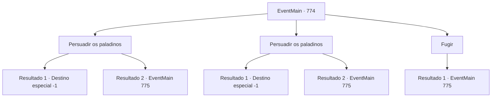

# Eventos principais · 774

[Índice da tabela](index.md) · [Índice geral](../index.md)

ID: `pt:EventMain:774` · Fonte: `EventMain4` · Versão: 1.2.47.

Mapeamento estático dos arquivos; a disponibilidade e a execução dependem do estado da run.

## Texto do evento

*Sem texto no arquivo.*

## Dados de entrada

```json
{
  "id": 774,
  "grade": 1,
  "normalGoal": "",
  "required": ""
}
```

## Mapa das escolhas



## Escolhas e resultados

### Escolha 1

Persuadir os paladinos

Requisitos e outros campos da escolha:

```json
{
  "required": "18_423_1"
}
```

#### Resultado 1.1

Você persuade os Paladinos de que não é assim. Se você quisesse trair, não havia motivo para voltar aqui. Onil acena impotente com as palavras. 

 "Certamente... há pouca chance de que ele tenha traído. Viyork"

 Logo, até Valen concorda, e Viyork se afasta da catedral envergonhado. Você suspira novamente e olha ao redor. Felizmente, os paladinos parecem concordar, mas ainda há desconfiança em seus olhos. Você foi enganado por Kior ao buscar a vingança errada, resultando nessa situação. Tudo o que resta de você, que não vingou Kior, Tere ou qualquer outra pessoa, é uma expressão de dúvida.

Continuação registrada: [Destino especial `-1`](../destinos-especiais.md).

```json
{
  "required": "",
  "chance": "1|0_7_1",
  "nextEvent": -1,
  "type": 0,
  "reward": "15_5_10|15_5_21|15_5_33|15_5_37"
}
```

#### Resultado 1.2

Você persuade os Paladinos de que não é assim. Se você quisesse trair, não havia motivo para voltar aqui. Mas Viyork não te ouve, e não ouve mais ninguém na Catedral de Yerut. 

 "O que você está fazendo? Esse traidor... Não! Segure o adorador de demônios!"

 Sob o comando de Viyork, os Paladinos te cercam e sacam suas armas.

Continuação registrada: [Evento 775](0775.md) na mesma tabela.

```json
{
  "required": "",
  "chance": "20",
  "nextEvent": 775,
  "type": 1,
  "reward": "6_2_50",
  "place": 10
}
```

### Escolha 2

Persuadir os paladinos

Requisitos e outros campos da escolha:

```json
{
  "required": "5_423_1"
}
```

#### Resultado 2.1

Você persuade os Paladinos de que não é assim. Se você quisesse trair, não havia motivo para voltar aqui. Onil acena impotente com as palavras. 

 "Certamente... há pouca chance de que ele tenha traído. Viyork"

 Logo, até Valen concorda, e Viyork se afasta da catedral envergonhado. Você suspira novamente e olha ao redor. Felizmente, os paladinos parecem concordar, mas ainda há desconfiança em seus olhos. Você foi enganado por Kior ao buscar a vingança errada, resultando nessa situação. Tudo o que resta de você, que não vingou Kior, Tere ou qualquer outra pessoa, é uma expressão de dúvida.

Continuação registrada: [Destino especial `-1`](../destinos-especiais.md).

```json
{
  "required": "",
  "chance": "1|0_7_1",
  "nextEvent": -1,
  "type": 0,
  "reward": "15_5_10|15_5_21|15_5_33|15_5_37"
}
```

#### Resultado 2.2

Você persuade os Paladinos de que não é assim. Se você quisesse trair, não havia motivo para voltar aqui. Mas Viyork não te ouve, e não ouve mais ninguém na Catedral de Yerut. 

 "O que você está fazendo? Esse traidor... Não! Segure o adorador de demônios!"

 Sob o comando de Viyork, os Paladinos te cercam e sacam suas armas.

Continuação registrada: [Evento 775](0775.md) na mesma tabela.

```json
{
  "required": "",
  "chance": "14",
  "nextEvent": 775,
  "type": 1,
  "reward": "6_2_50",
  "place": 10
}
```

### Escolha 3

Fugir

Requisitos e outros campos da escolha:

```json
{
  "required": ""
}
```

#### Resultado 3.1

Você dá um passo para trás, cauteloso com o ambiente. Viyork exclama nervosamente para a figura. 

 "O que você está fazendo? Esse traidor... Não! Segure o adorador de demônios!"

 Os Paladinos rapidamente te cercam e te bloqueiam. A retirada está bloqueada, e você silenciosamente coloca a mão na arma.

Continuação registrada: [Evento 775](0775.md) na mesma tabela.

```json
{
  "required": "",
  "chance": "1",
  "nextEvent": 775,
  "type": 2,
  "reward": "6_2_50",
  "place": 10
}
```

## Referências que chegam a este evento

- [Evento 773 · escolha 1 · resultado 1](0773.md#escolha-1)
- [Evento 777 · escolha 2 · resultado 1](0777.md#escolha-2)
