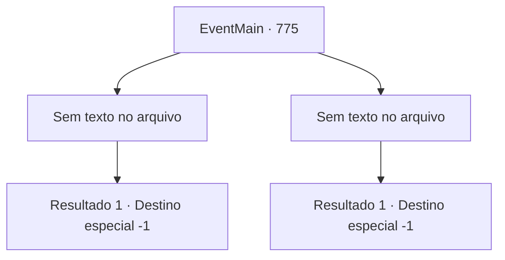

# Eventos principais · 775

[Índice da tabela](index.md) · [Índice geral](../index.md)

ID: `pt:EventMain:775` · Fonte: `EventMain4` · Versão: 1.2.47.

Mapeamento estático dos arquivos; a disponibilidade e a execução dependem do estado da run.

## Texto do evento

*Sem texto no arquivo.*

## Dados de entrada

```json
{
  "id": 775,
  "grade": 1,
  "normalGoal": "",
  "required": ""
}
```

## Mapa das escolhas



## Escolhas e resultados

### Escolha 1

*Sem texto no arquivo; o papel dessa opção depende da interface do jogo.*

Requisitos e outros campos da escolha:

```json
{
  "required": ""
}
```

#### Resultado 1.1

Escapar do cerco. Você foge da catedral. Talvez por causa do ferimento profundo, não há perseguição pelos Paladinos.

 Depois de correr por muito tempo e chegar a uma floresta desconhecida, você encosta as costas em uma árvore. Talvez seja porque você lutou um após o outro, mas você não tem forças. Você lentamente recupera o fôlego e olha para o céu. O céu do pôr do sol queima de vermelho. A cena é tão pacífica. Você percebe de repente que lágrimas escorrem pelo seu rosto. Você tropeça e continua andando novamente.

Continuação registrada: [Destino especial `-1`](../destinos-especiais.md).

```json
{
  "required": "",
  "chance": "1",
  "nextEvent": -1,
  "type": 2,
  "reward": "15_5_10|15_5_14|15_5_37"
}
```

### Escolha 2

*Sem texto no arquivo; o papel dessa opção depende da interface do jogo.*

Requisitos e outros campos da escolha:

```json
{
  "required": ""
}
```

#### Resultado 2.1

Você está ferido na última batalha. Você não consegue balançar sua arma tão forte quanto pensa e não consegue evitar os ataques inimigos. Eventualmente, você é derrotado e preso pelos Paladinos. Viyork grita, olhando para você acorrentado com desprezo. 

 "Coloquem-no na prisão! Nós o puniremos devidamente através de um julgamento!"

 Os Paladinos o arrastam sob seu comando.

Continuação registrada: [Destino especial `-1`](../destinos-especiais.md).

```json
{
  "required": "",
  "chance": "1",
  "nextEvent": -1,
  "type": 2,
  "reward": "0_0_-1|0_1_-1|15_5_2|15_5_14|15_5_37"
}
```

## Referências que chegam a este evento

- [Evento 774 · escolha 1 · resultado 2](0774.md#escolha-1)
- [Evento 774 · escolha 2 · resultado 2](0774.md#escolha-2)
- [Evento 774 · escolha 3 · resultado 1](0774.md#escolha-3)
