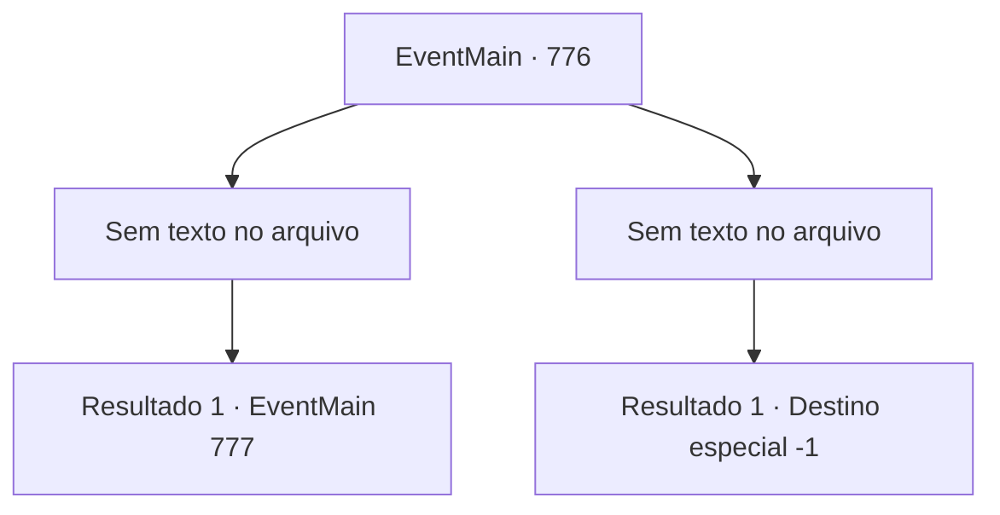

# Eventos principais · 776

[Índice da tabela](index.md) · [Índice geral](../index.md)

ID: `pt:EventMain:776` · Fonte: `EventMain4` · Versão: 1.2.47.

Mapeamento estático dos arquivos; a disponibilidade e a execução dependem do estado da run.

## Texto do evento

*Sem texto no arquivo.*

## Dados de entrada

```json
{
  "id": 776,
  "grade": 1,
  "normalGoal": "",
  "required": ""
}
```

## Mapa das escolhas



## Escolhas e resultados

### Escolha 1

*Sem texto no arquivo; o papel dessa opção depende da interface do jogo.*

Requisitos e outros campos da escolha:

```json
{
  "required": ""
}
```

#### Resultado 1.1


 "GRHEEAAAAH!!"

 Kior, que perdeu seu braço direito para você, grita. Sangue negro cai como uma cachoeira, e braços se espalham pelo chão com uma espada enorme. Naquele momento, a luz que se espalha da lacuna na dimensão enfraquece e gradualmente desaparece. Olhando para trás, você é o único que resta no palácio de Kior agora. 

 "Você está tentando fugir? Bem, não importa. No entanto, sua família deve estar muito decepcionada."

 No final de seu discurso, a visão flutua no ar. Na visão, duas almas estão presas em grades de ferro e gritam dolorosamente. Você conhece o grito. As almas são sua família. 

 "Khaha. Eles são pessoas tolas que se dedicam a salvá-lo da maldição. Agora, volte! Não se importe com sua família! Volte e console-se por não poder ajudá-los."


Continuação registrada: [Evento 777](0777.md) na mesma tabela.

```json
{
  "required": "",
  "chance": "1",
  "nextEvent": 777,
  "type": 2,
  "reward": ""
}
```

### Escolha 2

*Sem texto no arquivo; o papel dessa opção depende da interface do jogo.*

Requisitos e outros campos da escolha:

```json
{
  "required": ""
}
```

#### Resultado 2.1

Seu corpo se parte ao meio com um som alto. Kior ri de você, deixando apenas a parte superior do corpo. 

 "Khaha! Não pense que isso acaba com a morte. {1}. A morte não pode te libertar da dor."

 Você fecha os olhos, vomitando sangue. Vem um sono profundo em que você não consegue pensar no significado das palavras de Kior.

Continuação registrada: [Destino especial `-1`](../destinos-especiais.md).

```json
{
  "required": "",
  "chance": "1",
  "nextEvent": -1,
  "type": 2,
  "reward": "0_0_-1|0_1_-1|15_5_1|15_5_14|15_5_33"
}
```

## Referências que chegam a este evento

- [Evento 773 · escolha 2 · resultado 1](0773.md#escolha-2)
