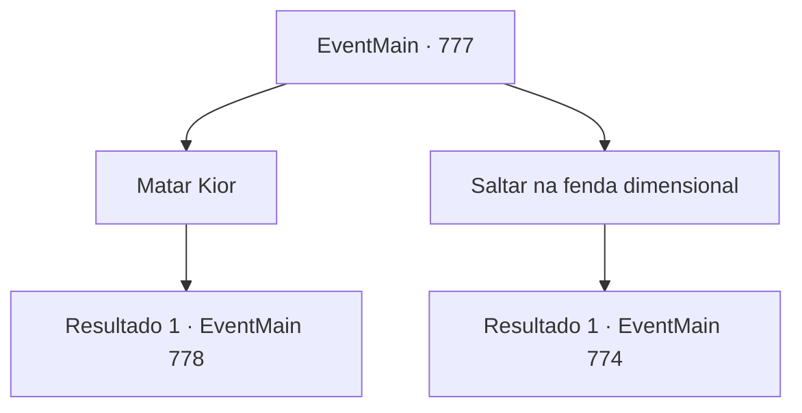

# Eventos principais · 777

[Índice da tabela](index.md) · [Índice geral](../index.md)

ID: `pt:EventMain:777` · Fonte: `EventMain4` · Versão: 1.2.47.

Mapeamento estático dos arquivos; a disponibilidade e a execução dependem do estado da run.

## Texto do evento

*Sem texto no arquivo.*

## Dados de entrada

```json
{
  "id": 777,
  "grade": 1,
  "normalGoal": "",
  "required": ""
}
```

## Mapa das escolhas



## Escolhas e resultados

### Escolha 1

Matar Kior

Requisitos e outros campos da escolha:

```json
{
  "required": ""
}
```

#### Resultado 1.1

Não há sentido em retornar ao mundo material a menos que você termine sua vingança. Se você pode salvar sua família, você pode ficar no inferno para sempre. Você não retorna ao portal. Você pula de volta em direção ao Kior. Então Kior ergue sua espada com o braço esquerdo e grita para você. 

 "Ótimo! Vamos ver como isso vai! {1}!!"

 A magia negra de Kior se lança em você. E a espada de Kior com seu braço esquerdo te atinge, que conseguiu evitar.

Continuação registrada: [Evento 778](0778.md) na mesma tabela.

```json
{
  "required": "",
  "chance": "1",
  "nextEvent": 778,
  "type": 2,
  "reward": "6_0_155",
  "place": 7
}
```

### Escolha 2

Saltar na fenda dimensional

Requisitos e outros campos da escolha:

```json
{
  "required": ""
}
```

#### Resultado 2.1

Você pula através de uma fenda na dimensão. Logo depois, uma luz quente te envolve.

 Quando você abre os olhos, vê a Catedral de Yerut. A maioria dos Paladinos não parece muito ferida, mas há uma atmosfera sombria, talvez por causa do choque da derrota. Você suspirou e se apoiou contra a coluna branca. Mas foi então. Viyork aponta para você e explode de raiva. 

 "Tudo isso é por causa de {1}! {1} conspirou com Danica e nos traiu!!"

 Os olhos de todos na catedral se voltam para você ao grito de Viyork. Eles têm dúvidas em seus olhos, mas não parecem ter certeza.

Continuação registrada: [Evento 774](0774.md) na mesma tabela.

```json
{
  "required": "",
  "chance": "1",
  "nextEvent": 774,
  "type": 2,
  "reward": "5_423_1"
}
```

## Referências que chegam a este evento

- [Evento 776 · escolha 1 · resultado 1](0776.md#escolha-1)
