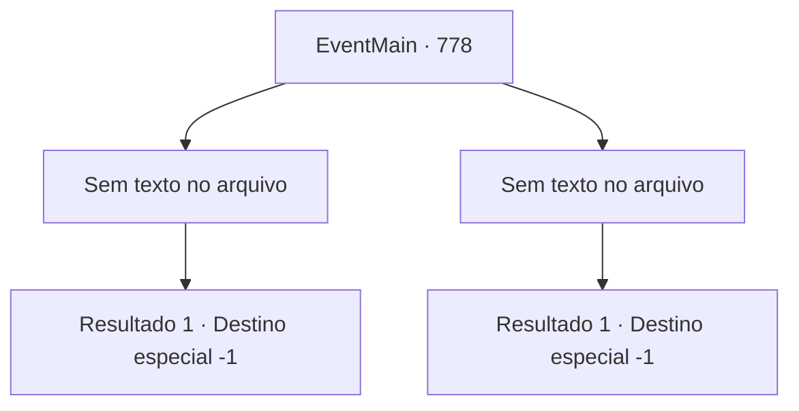

# Eventos principais · 778

[Índice da tabela](index.md) · [Índice geral](../index.md)

ID: `pt:EventMain:778` · Fonte: `EventMain4` · Versão: 1.2.47.

Mapeamento estático dos arquivos; a disponibilidade e a execução dependem do estado da run.

## Texto do evento

*Sem texto no arquivo.*

## Dados de entrada

```json
{
  "id": 778,
  "grade": 1,
  "normalGoal": "",
  "required": ""
}
```

## Mapa das escolhas



## Escolhas e resultados

### Escolha 1

*Sem texto no arquivo; o papel dessa opção depende da interface do jogo.*

Requisitos e outros campos da escolha:

```json
{
  "required": ""
}
```

#### Resultado 1.1


 "Eu... Eu...! Para um mero mortal!"

 Você derruba Kior após uma batalha feroz. Ele desmorona em pedaços com os olhos arregalados de incredulidade. 

 "Não consigo acreditar que Kior morreu por um humano!"

 "Maldição! Fugir!"

 Quando Kior morre, os demônios fogem do local em pânico. Absorvendo o poder do Príncipe, você lidera seu corpo cansado e procura por sua família. Se é isso que Kior mostrou a você antes, eles definitivamente estão aqui. Você caminha pelo palácio gritando o nome de sua família. |drawing_kiorDungeon| Você chega a uma prisão localizada nas profundezas do palácio de Kior. Você chama seus nomes em uma voz cuidadosa. Logo eles se voltam para o seu chamado, e você vê a família que sente falta. Você os abraça apertado.

Continuação registrada: [Destino especial `-1`](../destinos-especiais.md).

```json
{
  "required": "",
  "chance": "1",
  "nextEvent": -1,
  "type": 2,
  "reward": "15_5_21|15_5_32|15_5_37|15_5_39|15_5_42"
}
```

### Escolha 2

*Sem texto no arquivo; o papel dessa opção depende da interface do jogo.*

Requisitos e outros campos da escolha:

```json
{
  "required": ""
}
```

#### Resultado 2.1

Seu corpo se parte ao meio com um som alto. Kior ri de você, deixando apenas a parte superior do corpo. 

 "Khaha! Não pense que isso acaba com a morte. {1}. A morte não pode te libertar da dor."

 Você fecha os olhos, vomitando sangue. Vem um sono profundo em que você não consegue pensar no significado das palavras de Kior.

Continuação registrada: [Destino especial `-1`](../destinos-especiais.md).

```json
{
  "required": "",
  "chance": "1",
  "nextEvent": -1,
  "type": 2,
  "reward": "0_0_-1|0_1_-1|15_5_1|15_5_14|15_5_33"
}
```

## Referências que chegam a este evento

- [Evento 777 · escolha 1 · resultado 1](0777.md#escolha-1)
