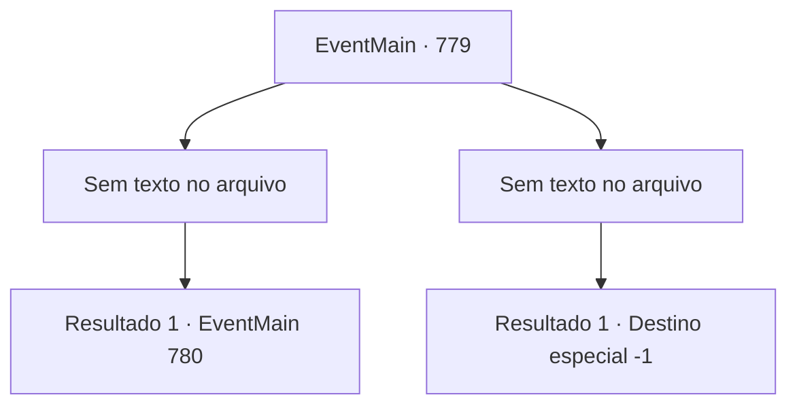

# Eventos principais · 779

[Índice da tabela](index.md) · [Índice geral](../index.md)

ID: `pt:EventMain:779` · Fonte: `EventMain4` · Versão: 1.2.47.

Mapeamento estático dos arquivos; a disponibilidade e a execução dependem do estado da run.

## Texto do evento

*Sem texto no arquivo.*

## Dados de entrada

```json
{
  "id": 779,
  "grade": 1,
  "normalGoal": "",
  "required": ""
}
```

## Mapa das escolhas



## Escolhas e resultados

### Escolha 1

*Sem texto no arquivo; o papel dessa opção depende da interface do jogo.*

Requisitos e outros campos da escolha:

```json
{
  "required": ""
}
```

#### Resultado 1.1


 "GRHEEAAAAH!!"

 Kior, que perdeu seu braço direito para você, grita. Sangue negro cai como uma cachoeira, e braços se espalham pelo chão com uma espada enorme. Naquele momento, a luz que se espalha pela fenda na dimensão enfraquece e gradualmente desaparece. Olhando para trás, Publius suspira depois de não conseguir abrir uma fenda na dimensão. Tropeçando entre os Paladinos caídos, ele grita em um suor frio. 

 "Não há outra maneira! Onil! Valen! Ajudem {1}!"

 Onil e Valen, que estavam lutando contra os demônios sob o comando de Publius, ficam ao seu lado. Então Kior levanta sua espada com seu braço esquerdo e grita como um grito. 

 "Ótimo! Vamos ver como isso vai! {1}!!"

 A magia negra de Kior se lança sobre você e os Paladinos Logo depois, a espada de Kior atinge você, que a evita.

Continuação registrada: [Evento 780](0780.md) na mesma tabela.

```json
{
  "required": "",
  "chance": "1",
  "nextEvent": 780,
  "type": 2,
  "reward": "6_2_155",
  "place": 7
}
```

### Escolha 2

*Sem texto no arquivo; o papel dessa opção depende da interface do jogo.*

Requisitos e outros campos da escolha:

```json
{
  "required": ""
}
```

#### Resultado 2.1

Seu corpo se parte ao meio com um som alto. Kior ri de você, deixando apenas a parte superior do corpo. 

 "Khaha! Não pense que isso acaba com a morte. {1}. A morte não pode te libertar da dor."

 Você fecha os olhos, vomitando sangue. Vem um sono profundo em que você não consegue pensar no significado das palavras de Kior.

Continuação registrada: [Destino especial `-1`](../destinos-especiais.md).

```json
{
  "required": "",
  "chance": "1",
  "nextEvent": -1,
  "type": 2,
  "reward": "0_0_-1|0_1_-1|15_5_1|15_5_14|15_5_33"
}
```

## Referências que chegam a este evento

- [Evento 771 · escolha 2 · resultado 1](0771.md#escolha-2)
