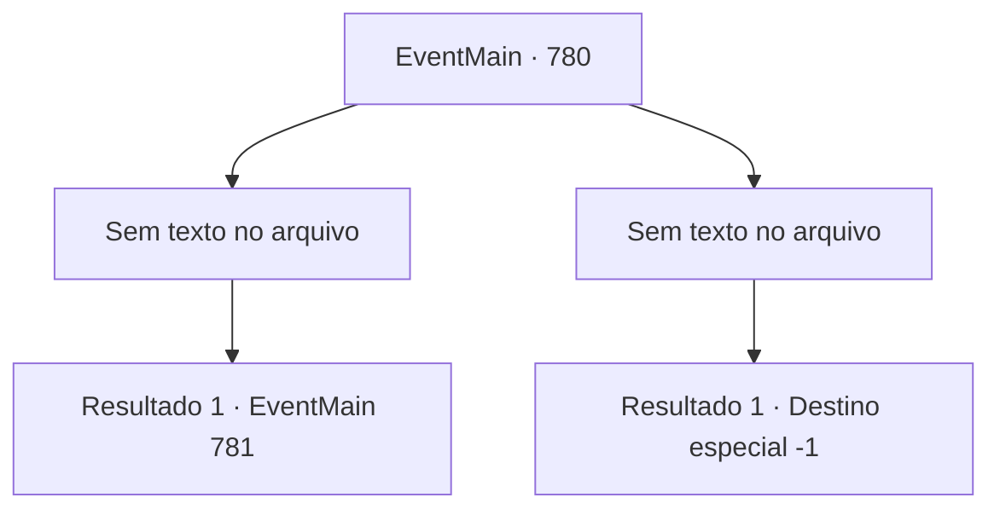

# Eventos principais · 780

[Índice da tabela](index.md) · [Índice geral](../index.md)

ID: `pt:EventMain:780` · Fonte: `EventMain4` · Versão: 1.2.47.

Mapeamento estático dos arquivos; a disponibilidade e a execução dependem do estado da run.

## Texto do evento

*Sem texto no arquivo.*

## Dados de entrada

```json
{
  "id": 780,
  "grade": 1,
  "normalGoal": "",
  "required": ""
}
```

## Mapa das escolhas



## Escolhas e resultados

### Escolha 1

*Sem texto no arquivo; o papel dessa opção depende da interface do jogo.*

Requisitos e outros campos da escolha:

```json
{
  "required": ""
}
```

#### Resultado 1.1


 "Eu... Eu...! Para um mero mortal!"

 Você derruba Kior após uma batalha feroz. Ele desmorona em pedaços com os olhos arregalados de incredulidade. <link=shake> 

 "WAAAGH!!"

</link> Os Paladinos que testemunharam a morte de Kior levantam os punhos e gritam. Os demônios que seguiram Kior se apressam para fugir, e Onil e Valen te ajudam. E Publius se aproxima e te dá tapinhas no ombro. 

 "Ótimo, Onil e Valen E... {1}"

 Você olha para o trono vazio do palácio. Você sente como se houvesse um vento soprando em seu peito.

Continuação registrada: [Evento 781](0781.md) na mesma tabela.

```json
{
  "required": "",
  "chance": "1",
  "nextEvent": 781,
  "type": 2,
  "reward": ""
}
```

### Escolha 2

*Sem texto no arquivo; o papel dessa opção depende da interface do jogo.*

Requisitos e outros campos da escolha:

```json
{
  "required": ""
}
```

#### Resultado 2.1

Seu corpo se parte ao meio com um som alto. Kior ri de você, deixando apenas o corpo superior. 

 "Khaha! Não pense que isso acaba com a morte. {1}. A morte não pode te libertar da dor."

 Você fecha os olhos, vomitando sangue. Valen, que lutou desesperadamente. Onil, que caiu antes de você, Publius e o resto dos Paladinos. Tudo isso depois de ser despedaçado e morto. Vem um sono profundo em que você não consegue pensar no significado das palavras de Kior.

Continuação registrada: [Destino especial `-1`](../destinos-especiais.md).

```json
{
  "required": "",
  "chance": "1",
  "nextEvent": -1,
  "type": 2,
  "reward": "0_0_-1|0_1_-1|15_5_1|15_5_14|15_5_33"
}
```

## Referências que chegam a este evento

- [Evento 779 · escolha 1 · resultado 1](0779.md#escolha-1)
