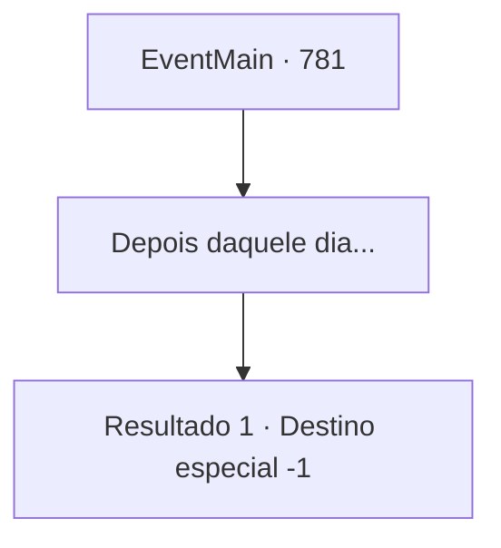

# Eventos principais · 781

[Índice da tabela](index.md) · [Índice geral](../index.md)

ID: `pt:EventMain:781` · Fonte: `EventMain4` · Versão: 1.2.47.

Mapeamento estático dos arquivos; a disponibilidade e a execução dependem do estado da run.

## Texto do evento

*Sem texto no arquivo.*

## Dados de entrada

```json
{
  "id": 781,
  "grade": 1,
  "normalGoal": "",
  "required": ""
}
```

## Mapa das escolhas



## Escolhas e resultados

### Escolha 1

Depois daquele dia...

Requisitos e outros campos da escolha:

```json
{
  "required": ""
}
```

#### Resultado 1.1

Há quanto tempo você terminou a vingança? Enquanto você está sentado ociosamente olhando para o céu do inferno, Onil se aproxima de repente e te leva para algum lugar. Mesmo quando você pergunta para onde ele está indo, ele pede para você descobrir por si mesmo. |drawing_kiorDungeon| E depois de muito tempo, Você chega a uma prisão localizada nas profundezas do palácio de Kior. Há duas almas presas lá. Você reconhece essas almas familiares. Você chama seus nomes com uma voz cuidadosa. Logo eles se voltam para o seu chamado, e você vê a família que sente falta. Você os abraça apertado.

Continuação registrada: [Destino especial `-1`](../destinos-especiais.md).

```json
{
  "required": "",
  "chance": "1",
  "nextEvent": -1,
  "type": 2,
  "reward": "15_5_32|15_5_36|15_5_39"
}
```

## Referências que chegam a este evento

- [Evento 780 · escolha 1 · resultado 1](0780.md#escolha-1)
