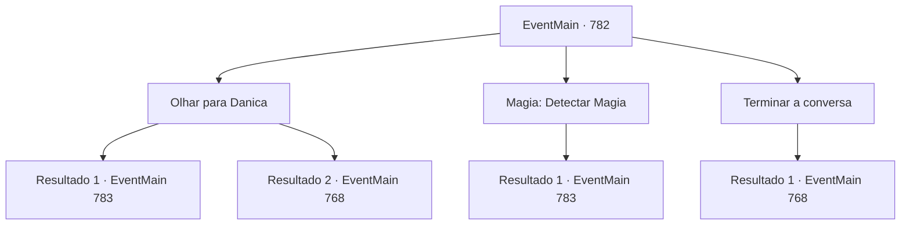

# Eventos principais · 782

[Índice da tabela](index.md) · [Índice geral](../index.md)

ID: `pt:EventMain:782` · Fonte: `EventMain4` · Versão: 1.2.47.

Mapeamento estático dos arquivos; a disponibilidade e a execução dependem do estado da run.

## Texto do evento

*Sem texto no arquivo.*

## Dados de entrada

```json
{
  "id": 782,
  "grade": 1,
  "normalGoal": "",
  "required": ""
}
```

## Mapa das escolhas



## Escolhas e resultados

### Escolha 1

Olhar para Danica

Requisitos e outros campos da escolha:

```json
{
  "required": "5_422_1"
}
```

#### Resultado 1.1

Sentindo-se desconfortável, você olha para Danica. Ela parece a mesma de antes, mas você tem uma sensação sinistra e familiar. 

 "O que está acontecendo? {1}."

 Em sua voz, você percebe subitamente a sensação familiar. A magia de Kior emerge dela, o sacerdote do Tere, que comandará o círculo mágico amanhã. 

 "Você entendeu?"

 Danica chuta a língua e retira a adaga de seus braços. Logo sua adaga, que brilha intensamente, voa em sua direção.

Continuação registrada: [Evento 783](0783.md) na mesma tabela.

```json
{
  "required": "",
  "chance": "1|0_14_1",
  "nextEvent": 783,
  "type": 0,
  "reward": "6_0_131",
  "place": 10
}
```

#### Resultado 1.2

Sentindo-se desconfortável, você olha para Danica. Mas você não encontra nada estranho e volta para o seu alojamento.

 No dia seguinte, você vai para a catedral na hora certa. Ao entrar na praça atrás da catedral, há muitos paladinos fortemente armados se preparando para a batalha. Publius aumenta a moral com seus discursos e, eventualmente, Danica aparece e fica no centro do círculo mágico. 

 "Um grande homem! Os Cordeiros se reúnem para rezar! Por favor, nos dê um meio de nos conectarmos com o mundo."

 Enquanto Danica recita um feitiço, a luz se espalha a partir do círculo mágico. Caracteres rúnicos esculpidos no chão surgem no ar e giram ao redor da catedral, e uma mana forte varre como uma rajada de vento. <color=red> 

 "Kior! Por favor, mostre-me o seu mundo."

</color> Então, o mundo vira de cabeça para baixo em sua última palavra.

Continuação registrada: [Evento 768](0768.md) na mesma tabela.

```json
{
  "required": "",
  "chance": "18",
  "nextEvent": 768,
  "type": 1,
  "reward": ""
}
```

### Escolha 2

Magia: Detectar Magia

Requisitos e outros campos da escolha:

```json
{
  "required": "5_422_1|20_0_1"
}
```

#### Resultado 2.1

Num estranho sentido de contradição, você usa Detectar Magia. Ela parece a mesma de antes, mas você tem uma sensação sinistra e familiar. Quando você tenta magia, magia negra brota dela. A magia de Kior emerge dela, o sacerdote do Tere, que irá conduzir o círculo mágico amanhã. 

 "Entendeu?"

 Danica chuta a língua e retira a adaga de seus braços. Logo sua adaga, que brilha intensamente, voa em sua direção.

Continuação registrada: [Evento 783](0783.md) na mesma tabela.

```json
{
  "required": "",
  "chance": "1",
  "nextEvent": 783,
  "type": 2,
  "reward": "6_0_131",
  "place": 10
}
```

### Escolha 3

Terminar a conversa

Requisitos e outros campos da escolha:

```json
{
  "required": ""
}
```

#### Resultado 3.1

Você volta para o alojamento depois de conversar com ela. Como o alojamento é uma pousada de luxo, você passa uma noite mais confortável do que nos outros dias.

 No dia seguinte, você vai para a catedral na hora certa. Ao entrar na praça atrás da catedral, há muitos paladinos fortemente armados se preparando para a batalha. Publius levanta o moral com seus discursos e, eventualmente, Danica aparece e fica no centro do círculo mágico. 

 "Um grande homem! Os Cordeiros se reúnem para rezar! Por favor, nos dê um caminho para nos conectarmos com o mundo."

 Enquanto Danica recita um feitiço, a luz se espalha a partir do círculo mágico. Caracteres rúnicos esculpidos no chão surgem no ar e giram ao redor da catedral, e uma mana poderosa varre como uma rajada de vento. <color=red> 

 "Kior! Por favor, mostre-me o seu mundo."

</color> Então, o mundo vira de cabeça para baixo em sua última palavra.

Continuação registrada: [Evento 768](0768.md) na mesma tabela.

```json
{
  "required": "",
  "chance": "1",
  "nextEvent": 768,
  "type": 2,
  "reward": ""
}
```

## Referências que chegam a este evento

- [Evento 767 · escolha 2 · resultado 1](0767.md#escolha-2)
- [Evento 767 · escolha 2 · resultado 2](0767.md#escolha-2)
