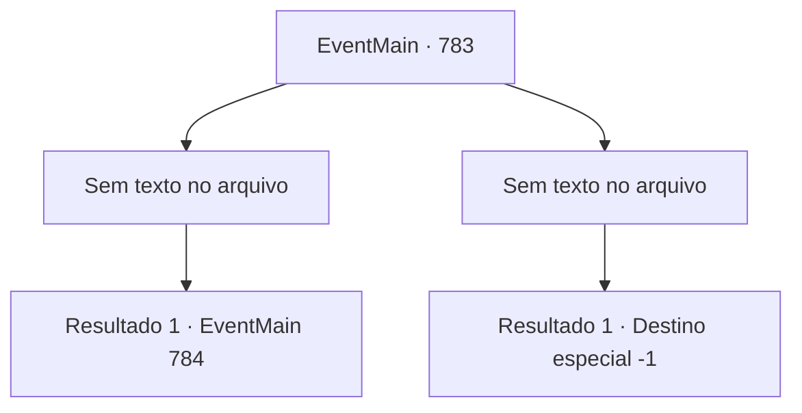

# Eventos principais · 783

[Índice da tabela](index.md) · [Índice geral](../index.md)

ID: `pt:EventMain:783` · Fonte: `EventMain4` · Versão: 1.2.47.

Mapeamento estático dos arquivos; a disponibilidade e a execução dependem do estado da run.

## Texto do evento

*Sem texto no arquivo.*

## Dados de entrada

```json
{
  "id": 783,
  "grade": 1,
  "normalGoal": "",
  "required": ""
}
```

## Mapa das escolhas



## Escolhas e resultados

### Escolha 1

*Sem texto no arquivo; o papel dessa opção depende da interface do jogo.*

Requisitos e outros campos da escolha:

```json
{
  "required": ""
}
```

#### Resultado 1.1

Você carrega a caída Danica e segue para a catedral. Você visita Publius, conta a ele sobre Danica e pede por seu tratamento. 

 "Surpreso. Eu não sabia que Danica estava sendo controlada mentalmente..."

 Publius, que examinou sua condição, franze a testa e agradece a você. 

 "Obrigado. {1}. Não sei o que teria acontecido se Danica tivesse tentado usar a magia..."

 Mais tarde, Publius envia Danica para o centro de tratamento com seus homens. Ele diz que irá investigar após libertá-la do controle mental. 

 "Se demorarmos mais, não sabemos que tipo de truque Kior pode fazer. Vou chamá-lo assim que puder."

 Publius fala com firmeza e olha para você.

Continuação registrada: [Evento 784](0784.md) na mesma tabela.

```json
{
  "required": "",
  "chance": "1",
  "nextEvent": 784,
  "type": 2,
  "reward": ""
}
```

### Escolha 2

*Sem texto no arquivo; o papel dessa opção depende da interface do jogo.*

Requisitos e outros campos da escolha:

```json
{
  "required": ""
}
```

#### Resultado 2.1

Tentas evitar a adaga, mas eventualmente permites um ataque. Sangue está jorrando no golpe fatal que penetrou o coração. Danica sussurra para ti enquanto olha para isso. 

 "Estou grata por {1}. Graças ao teu sequestro... eu sigo Kior."


Continuação registrada: [Destino especial `-1`](../destinos-especiais.md).

```json
{
  "required": "",
  "chance": "1",
  "nextEvent": -1,
  "type": 2,
  "reward": "0_0_-1|0_1_-1|15_5_1|15_5_33"
}
```

## Referências que chegam a este evento

- [Evento 782 · escolha 1 · resultado 1](0782.md#escolha-1)
- [Evento 782 · escolha 2 · resultado 1](0782.md#escolha-2)
