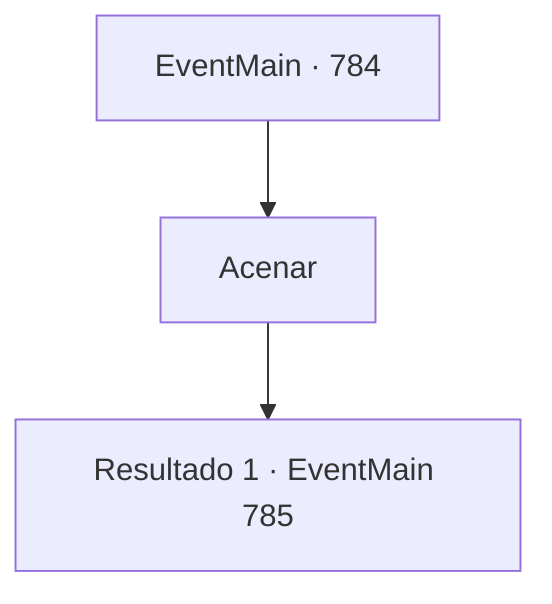

# Eventos principais · 784

[Índice da tabela](index.md) · [Índice geral](../index.md)

ID: `pt:EventMain:784` · Fonte: `EventMain4` · Versão: 1.2.47.

Mapeamento estático dos arquivos; a disponibilidade e a execução dependem do estado da run.

## Texto do evento

*Sem texto no arquivo.*

## Dados de entrada

```json
{
  "id": 784,
  "grade": 1,
  "normalGoal": "",
  "required": ""
}
```

## Mapa das escolhas



## Escolhas e resultados

### Escolha 1

Acenar

Requisitos e outros campos da escolha:

```json
{
  "required": ""
}
```

#### Resultado 1.1

Você acena para Publius e segue para a praça atrás da catedral com ele. Publius pede aos sacerdotes que reúnam os Paladinos. 

 Logo em seguida, muitos Paladinos fortemente armados se reúnem na praça, totalmente preparados. Publius faz um discurso e inspira a moral, e logo ele está no centro do círculo mágico. 

 "Oh Grande Tere, seu filho está aqui por você. Por favor, nos dê força."

 Enquanto Publius recita um feitiço, a luz se espalha a partir do círculo mágico. Caracteres rúnicos esculpidos no chão surgem no ar e circulam ao redor da catedral, e uma forte mana varre como uma rajada de vento. 

 "Tere! Por favor, envie seu inimigo aqui!"

 E, em sua última palavra, a luz pisca.

Continuação registrada: [Evento 785](0785.md) na mesma tabela.

```json
{
  "required": "",
  "chance": "1",
  "nextEvent": 785,
  "type": 2,
  "reward": ""
}
```

## Referências que chegam a este evento

- [Evento 783 · escolha 1 · resultado 1](0783.md#escolha-1)
