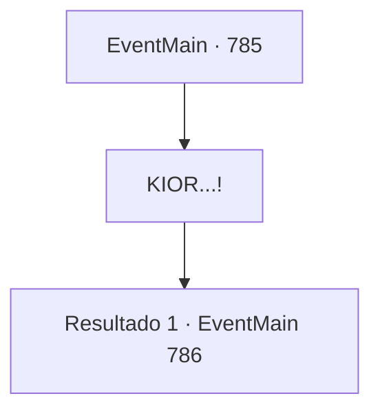

# Eventos principais · 785

[Índice da tabela](index.md) · [Índice geral](../index.md)

ID: `pt:EventMain:785` · Fonte: `EventMain4` · Versão: 1.2.47.

Mapeamento estático dos arquivos; a disponibilidade e a execução dependem do estado da run.

## Texto do evento

*Sem texto no arquivo.*

## Dados de entrada

```json
{
  "id": 785,
  "grade": 1,
  "normalGoal": "",
  "required": ""
}
```

## Mapa das escolhas



## Escolhas e resultados

### Escolha 1

KIOR...!

Requisitos e outros campos da escolha:

```json
{
  "required": ""
}
```

#### Resultado 1.1

À medida que a luz diminui gradualmente, um kior emerge sobre o círculo mágico. O kior tem uma altura que pode alcançar o teto da catedral, e toda a catedral ressoa alto, mesmo em um tom baixo. Diz Kior, olhando para baixo para você e os Paladinos com olhos vermelhos como sangue. 

 "É ridículo. Não é o Tere. É o mortal do Tere. Você realmente acha que pode me derrubar?"

 Publius grita para o Kior com todas as suas forças. 

 "Todos! Ataquem o demônio! Ele está sendo arrastado para o mundo material e enfraquecido! Devemos nos livrar dele aqui e agora!!"

 Uma corrente dourada sai de sua voz e agarra Kior. Valen e outros Paladinos avançam contra ele, e a luz jorra dos sacerdotes como uma chuva de meteoros. Você também salta em direção ao Kior.

Continuação registrada: [Evento 786](0786.md) na mesma tabela.

```json
{
  "required": "",
  "chance": "1",
  "nextEvent": 786,
  "type": 2,
  "reward": "6_2_155",
  "place": 10
}
```

## Referências que chegam a este evento

- [Evento 784 · escolha 1 · resultado 1](0784.md#escolha-1)
