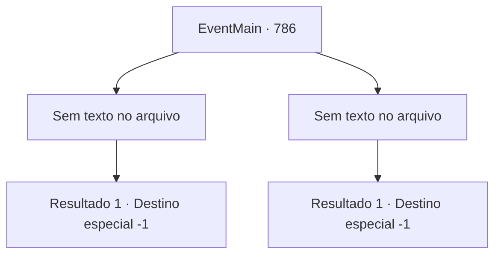

# Eventos principais · 786

[Índice da tabela](index.md) · [Índice geral](../index.md)

ID: `pt:EventMain:786` · Fonte: `EventMain4` · Versão: 1.2.47.

Mapeamento estático dos arquivos; a disponibilidade e a execução dependem do estado da run.

## Texto do evento

*Sem texto no arquivo.*

## Dados de entrada

```json
{
  "id": 786,
  "grade": 1,
  "normalGoal": "",
  "required": ""
}
```

## Mapa das escolhas



## Escolhas e resultados

### Escolha 1

*Sem texto no arquivo; o papel dessa opção depende da interface do jogo.*

Requisitos e outros campos da escolha:

```json
{
  "required": ""
}
```

#### Resultado 1.1


 "GRHEEAAAAH!!"

 Kior, que perdeu seu braço direito para você, grita. Sangue negro cai como uma cachoeira, e braços se espalham pelo chão com uma espada enorme. Não perdendo a oportunidade, os Paladinos tentam atacar novamente. 

 "Você acha que vou morrer assim?"

 Mas mesmo nessa situação, Kior empunha seu braço restante em um frenesi. Foi apenas uma luta, mas vários paladinos caíram. Você para por um momento e observa a oportunidade. 

 "{1}...!!!"

 E quando o olhar de Kior se direciona a você, você avança e faz o ataque final. Ele desmorona em pedaços com os olhos arregalados de incredulidade. <link=shake> 

 "WAAAGH!!"

</link> Os Paladinos que testemunharam a morte de Kior erguem os punhos e gritam. Todos na catedral estão intoxicados com a alegria da vitória. Logo, Publius se aproxima e dá tapinhas em seu ombro. 

 "Bom trabalho. {1}. Sua contribuição foi fundamental para derrotar Kior."

 Com suas palavras, você desaba, sentindo que tudo acabou. Talvez seja por causa da batalha intensa, mas meu corpo não está mais tenso. Você olha pela janela para a luz do sol e imagina os rostos de sua família.

Continuação registrada: [Destino especial `-1`](../destinos-especiais.md).

```json
{
  "required": "",
  "chance": "1",
  "nextEvent": -1,
  "type": 2,
  "reward": "15_5_6|15_5_20|15_5_32"
}
```

### Escolha 2

*Sem texto no arquivo; o papel dessa opção depende da interface do jogo.*

Requisitos e outros campos da escolha:

```json
{
  "required": ""
}
```

#### Resultado 2.1

O kior que apareceu no mundo material é tão poderoso que você não pode acreditar que está enfraquecido. Ele corta as correntes douradas que prendem seu corpo de uma vez e calmamente recebe a luz dos sacerdotes. E ele balança uma espada gigante nos Paladinos e os parte ao meio. 

 "Tere! Olhe! Olhe para o seu servo se curvando para mim! Eu irei profanar a terra do seu poder!"

 Ele pisoteia Publius como se estivesse matando um inseto. E então ele destrói a Catedral de Yerut, devorando os corpos com magia negra para transformá-los em mortos-vivos. Você, que está testemunhando a cena, também está dividido. A escuridão te envolve.

Continuação registrada: [Destino especial `-1`](../destinos-especiais.md).

```json
{
  "required": "",
  "chance": "1",
  "nextEvent": -1,
  "type": 2,
  "reward": "0_0_-1|0_1_-1|15_5_14|15_5_33"
}
```

## Referências que chegam a este evento

- [Evento 785 · escolha 1 · resultado 1](0785.md#escolha-1)
