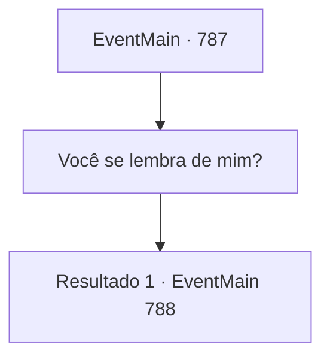

# Eventos principais · 787

[Índice da tabela](index.md) · [Índice geral](../index.md)

ID: `pt:EventMain:787` · Fonte: `EventMain4` · Versão: 1.2.47.

Mapeamento estático dos arquivos; a disponibilidade e a execução dependem do estado da run.

## Texto do evento

*Sem texto no arquivo.*

## Dados de entrada

```json
{
  "id": 787,
  "grade": 1,
  "normalGoal": "",
  "required": ""
}
```

## Mapa das escolhas



## Escolhas e resultados

### Escolha 1

Você se lembra de mim?

Requisitos e outros campos da escolha:

```json
{
  "required": ""
}
```

#### Resultado 1.1

Onil hesita em dizer isso. 

 "... Claro. Ouvi da Danica. Quer que eu peça desculpas?"

 Onil continua com uma voz confiante. 

 "Deve ter sido uma tragédia para você. Mas foi pela justiça. Sou servo da Tere. Não me arrependo e farei novamente se a mesma coisa acontecer."

 Ele fala com uma expressão calma. 

 "Entendo que você está me culpando. No entanto, precisamos enterrar o passado e unir forças para nossos objetivos."

 Ele acrescenta que aceitará mais tarde se você quiser enfrentá-lo.

Continuação registrada: [Evento 788](0788.md) na mesma tabela.

```json
{
  "required": "",
  "chance": "1",
  "nextEvent": 788,
  "type": 2,
  "reward": ""
}
```

## Referências que chegam a este evento

- [Evento 767 · escolha 3 · resultado 1](0767.md#escolha-3)
