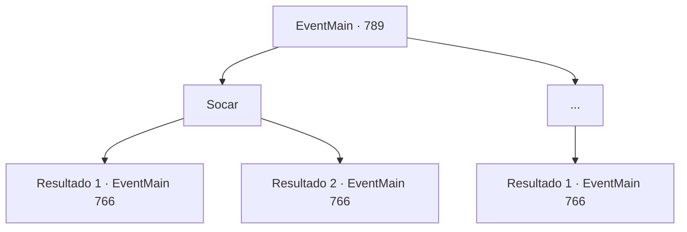

# Eventos principais · 789

[Índice da tabela](index.md) · [Índice geral](../index.md)

ID: `pt:EventMain:789` · Fonte: `EventMain4` · Versão: 1.2.47.

Mapeamento estático dos arquivos; a disponibilidade e a execução dependem do estado da run.

## Texto do evento

*Sem texto no arquivo.*

## Dados de entrada

```json
{
  "id": 789,
  "grade": 1,
  "normalGoal": "",
  "required": ""
}
```

## Mapa das escolhas



## Escolhas e resultados

### Escolha 1

Socar

Requisitos e outros campos da escolha:

```json
{
  "required": ""
}
```

#### Resultado 1.1

Você fecha o punho e acerta com força na bochecha de Onil. Então Onil cai e desmaia com um barulho alto. Olhando para Onil, você sacode as mãos e sobe as escadas procurando por Publius.

 Caminhando pelo chão de mármore branco, você vê uma praça grande atrás da catedral. Na praça, há um enorme círculo mágico gravado com dezenas de milhares de runas, e vários instrumentos mágicos estão instalados ao redor do círculo mágico. Publius está rezando respeitosamente no centro da praça. Conforme você se aproxima, Publius se vira e olha para você. 

 "Está na hora {1}. Você está pronto? Mas..."

 Publius vira a cabeça como se estivesse procurando alguém. E logo depois, Onil segue você até a praça. 

 "Peço desculpas por estar atrasado."

 Onil se desculpa com o Arcebispo e fica atrás de você.

Continuação registrada: [Evento 766](0766.md) na mesma tabela.

```json
{
  "required": "",
  "chance": "1|0_5_1",
  "nextEvent": 766,
  "type": 0,
  "reward": ""
}
```

#### Resultado 1.2

Você fecha o punho e acerta com força na bochecha de Onil. Então, com um barulho alto, o rosto de Onil vira e sangue escorre de sua boca. Onil limpa o sangue com a manga e vira as costas para te guiar.

 Caminhando pelo chão de mármore branco, você vê um grande quadrado atrás da catedral. No quadrado, há um enorme círculo mágico gravado com dezenas de milhares de runas, e vários instrumentos mágicos estão instalados ao redor do círculo mágico. 

 "{1} está aqui, o arcebispo"

 Publius está rezando respeitosamente no centro do quadrado. Com as palavras de Onil, Publius se vira e olha para você. 

 "Está na hora, {1}. Você está pronto?"


Continuação registrada: [Evento 766](0766.md) na mesma tabela.

```json
{
  "required": "",
  "chance": "18",
  "nextEvent": 766,
  "type": 1,
  "reward": ""
}
```

### Escolha 2

...

Requisitos e outros campos da escolha:

```json
{
  "required": ""
}
```

#### Resultado 2.1

Você está em silêncio. Onil olha para você calmamente e vira as costas para você. 

 "Então eu vou continuar a guiar"

 Você segue Onil para dentro da catedral. Caminhando pelo chão de mármore branco, você vê um grande quadrado atrás da catedral. Na praça, há um enorme círculo mágico gravado com dezenas de milhares de runas, e várias ferramentas magias estão instaladas ao redor do círculo mágico. 

 "{1} está aqui, o arcebispo"

 Publius está rezando respeitosamente no centro da praça. Nas palavras de Onil, Publius se vira e olha para você. 

 "Está na hora {1}. Você está pronto?"


Continuação registrada: [Evento 766](0766.md) na mesma tabela.

```json
{
  "required": "",
  "chance": "1",
  "nextEvent": 766,
  "type": 2,
  "reward": ""
}
```

## Referências que chegam a este evento

- [Evento 765 · escolha 2 · resultado 1](0765.md#escolha-2)
