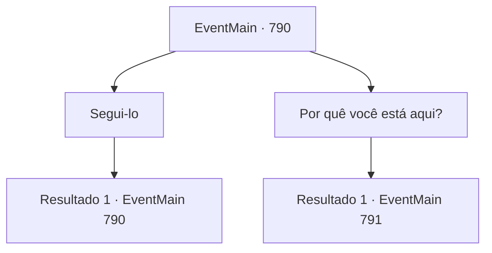

# Eventos principais · 790

[Índice da tabela](index.md) · [Índice geral](../index.md)

ID: `pt:EventMain:790` · Fonte: `EventMain4` · Versão: 1.2.47.

Mapeamento estático dos arquivos; a disponibilidade e a execução dependem do estado da run.

## Texto do evento

Você, como havia prometido a Valen, passou por uma pequena cidade chamada 'Arhena'. A cidade estava localizada na base de um grande vulcão chamado 'Grecino', conhecido como o 'A Fornalha dos Deuses', e era famosa por suas fontes termais de enxofre. Ao observar uma fonte que exalava águas quentes, alguém encapuzado se aproximou de você. 

 "Você chegou. Siga-me."

 Ao ouvir a voz, você imediatamente reconheceu quem era. Era Valen, que, como da última vez, estava ao seu lado em sua missão de vingança contra o demônio.

## Dados de entrada

```json
{
  "id": 790,
  "grade": 1,
  "normalGoal": "",
  "required": "1_2_100|13_4_21"
}
```

## Mapa das escolhas



## Escolhas e resultados

### Escolha 1

Segui-lo

Requisitos e outros campos da escolha:

```json
{
  "required": "5_424_0"
}
```

#### Resultado 1.1

Você segue Valen até o Monte Grecino. Grecino é solitário, sem uma única árvore, e os gêiseres estão por toda parte. Ande por um longo tempo. Você chega a um lago fumegante no meio da montanha. Há uma pequena caverna na beira do lago. Enquanto caminha à frente, Valen tira sua capa e entrega algo para você. É um Rosário feito de prata. 

 "É uma ferramenta magia que protege contra o controle mental do demônio. Certifique-se de usá-lo."


Continuação registrada: [Evento 790](0790.md) na mesma tabela.

```json
{
  "required": "",
  "chance": "1",
  "nextEvent": 790,
  "type": 2,
  "reward": "5_424_1|3_251_1"
}
```

### Escolha 2

Por quê você está aqui?

Requisitos e outros campos da escolha:

```json
{
  "required": "5_424_1"
}
```

#### Resultado 2.1

Ela explica em uma voz calma quando perguntada por você. 

 "Demônios como Kior são ressuscitados no inferno mesmo se morrerem no mundo material. É por isso que você deve pular no inferno para matá-lo."

 Valen se vira para a paisagem do Monte Grecino e diz. 

 "De acordo com um documento na Grande biblioteca da igreja, há um caminho em algum lugar. Dizia, 'Há um caminho para o inferno no abismo profundo onde a destruição está escondida.', mas eu não sei exatamente onde é."

 Ela diz que você deve encontrá-lo com ela.

Continuação registrada: [Evento 791](0791.md) na mesma tabela.

```json
{
  "required": "",
  "chance": "1",
  "nextEvent": 791,
  "type": 2,
  "reward": "5_424_2"
}
```

## Referências que chegam a este evento

- [Evento 790 · escolha 1 · resultado 1](0790.md#escolha-1)
