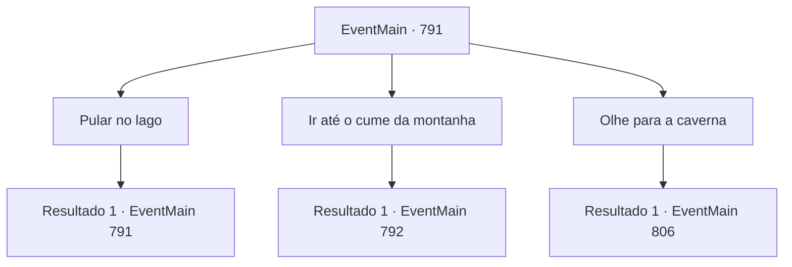

# Eventos principais · 791

[Índice da tabela](index.md) · [Índice geral](../index.md)

ID: `pt:EventMain:791` · Fonte: `EventMain4` · Versão: 1.2.47.

Mapeamento estático dos arquivos; a disponibilidade e a execução dependem do estado da run.

## Texto do evento

*Sem texto no arquivo.*

## Dados de entrada

```json
{
  "id": 791,
  "grade": 1,
  "normalGoal": "",
  "required": ""
}
```

## Mapa das escolhas



## Escolhas e resultados

### Escolha 1

Pular no lago

Requisitos e outros campos da escolha:

```json
{
  "required": "5_425_0|5_426_0"
}
```

#### Resultado 1.1


 "Não tenho certeza, mas..."

 Você pula no lago e procura por um passagem antes que as palavras de Valen terminem. O lago é mais profundo do que você pensa, mas olhar para o fundo é fácil. Mas não importa o quanto você olhe, você não vê uma passagem. Valen murmura enquanto te vê saindo da água. 

 "Escute até o final. A passagem está pelo menos perto do topo da montanha..."


Continuação registrada: [Evento 791](0791.md) na mesma tabela.

```json
{
  "required": "",
  "chance": "1",
  "nextEvent": 791,
  "type": 2,
  "reward": "5_425_1"
}
```

### Escolha 2

Ir até o cume da montanha

Requisitos e outros campos da escolha:

```json
{
  "required": "-1|5_425_1|5_426_1"
}
```

#### Resultado 2.1

Você segue com Valen até o topo do Monte Grecino. No caminho para o cume, Valen vasculha a rua, mas não consegue encontrar uma passagem. Após chegar ao topo da montanha, você olha ao redor. Há fumaça acre subindo do cratera e um cheiro quente e fétido. 

 "...Não acho que seja por aqui. Foi tudo em vão?"

 Você olha para dentro da cratera. A lava está borbulhando. 

 'Basss...'

 Você dá um passo para trás. Nesse momento, parte da cratera desmorona e pilhas de pedras caem na lava. Mas a forma da lava não muda em nada. As rochas desaparecem como se estivessem passando pela lava.

Continuação registrada: [Evento 792](0792.md) na mesma tabela.

```json
{
  "required": "",
  "chance": "1",
  "nextEvent": 792,
  "type": 2,
  "reward": ""
}
```

### Escolha 3

Olhe para a caverna

Requisitos e outros campos da escolha:

```json
{
  "required": "5_425_0|5_426_0"
}
```

#### Resultado 3.1

 'Pusss--!'

 Um gêiser jorra e o chão treme um pouco. Você caminha ao redor da margem do lago e entra na caverna, seguido por Valen. É um lugar enorme e espaçoso, com muitos morcegos pendurados. Valen entra na caverna com uma expressão levemente irritada. 

 "Ei, me escute até o fim."

 Nesse momento, os morcegos abrem os olhos ao ouvirem sua voz e avançam em sua direção. Ondas de milhares de morcegos se lançam sobre você.

Continuação registrada: [Evento 806](0806.md) na mesma tabela.

```json
{
  "required": "",
  "chance": "1",
  "nextEvent": 806,
  "type": 2,
  "reward": "5_426_1|6_0_66",
  "place": 6
}
```

## Referências que chegam a este evento

- [Evento 790 · escolha 2 · resultado 1](0790.md#escolha-2)
- [Evento 791 · escolha 1 · resultado 1](0791.md#escolha-1)
- [Evento 806 · escolha 1 · resultado 1](0806.md#escolha-1)
- [Evento 806 · escolha 2 · resultado 1](0806.md#escolha-2)
