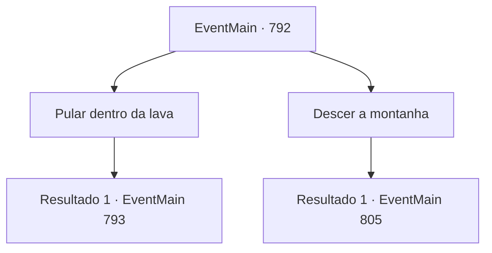

# Eventos principais · 792

[Índice da tabela](index.md) · [Índice geral](../index.md)

ID: `pt:EventMain:792` · Fonte: `EventMain4` · Versão: 1.2.47.

Mapeamento estático dos arquivos; a disponibilidade e a execução dependem do estado da run.

## Texto do evento

*Sem texto no arquivo.*

## Dados de entrada

```json
{
  "id": 792,
  "grade": 1,
  "normalGoal": "",
  "required": ""
}
```

## Mapa das escolhas



## Escolhas e resultados

### Escolha 1

Pular dentro da lava

Requisitos e outros campos da escolha:

```json
{
  "required": ""
}
```

#### Resultado 1.1

Você conta a Valen o que viu e explica que haverá uma passagem no cratera. Ela não acredita no começo. Você empurra a pedra de volta para o cratera, e então ela concorda. 

 "... É estranho. Vou confiar em você desta vez. {1}."

 Você pula no cratera com Valen. E então você cai na lava. Você não sente nenhum calor na lava, mas ouve algo rasgando.

Continuação registrada: [Evento 793](0793.md) na mesma tabela.

```json
{
  "required": "",
  "chance": "1",
  "nextEvent": 793,
  "type": 2,
  "reward": ""
}
```

### Escolha 2

Descer a montanha

Requisitos e outros campos da escolha:

```json
{
  "required": "5_427_0"
}
```

#### Resultado 2.1

Sem perceber nada de estranho, você desce a montanha com Valen. Mesmo depois de procurar o vulcão por muito tempo, você não consegue encontrar um caminho para a dimensão de Kior.

Continuação registrada: [Evento 805](0805.md) na mesma tabela.

```json
{
  "required": "",
  "chance": "1",
  "nextEvent": 805,
  "type": 2,
  "reward": "5_427_1"
}
```

## Referências que chegam a este evento

- [Evento 791 · escolha 2 · resultado 1](0791.md#escolha-2)
- [Evento 805 · escolha 2 · resultado 1](0805.md#escolha-2)
