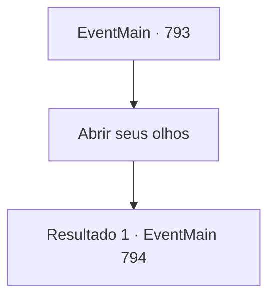

# Eventos principais · 793

[Índice da tabela](index.md) · [Índice geral](../index.md)

ID: `pt:EventMain:793` · Fonte: `EventMain4` · Versão: 1.2.47.

Mapeamento estático dos arquivos; a disponibilidade e a execução dependem do estado da run.

## Texto do evento

*Sem texto no arquivo.*

## Dados de entrada

```json
{
  "id": 793,
  "grade": 1,
  "normalGoal": "",
  "required": ""
}
```

## Mapa das escolhas



## Escolhas e resultados

### Escolha 1

Abrir seus olhos

Requisitos e outros campos da escolha:

```json
{
  "required": ""
}
```

#### Resultado 1.1

Você recupera os sentidos e olha fixamente para a cena diante de você. |drawing_darkPrinceLand| Parece que os humanos já viveram ali. Mas se há uma grande diferença entre outras cidades abandonadas, Chuva negra cai do céu como óleo, e as chamas azuis escuras estão queimando a terra. Além da cidade, um gás turquesa sobe de uma montanha de ossos brancos. 

 "Se isso é o inferno, deve haver Kior"

 Valen, que apareceu antes que você percebesse, aponta para o topo da montanha que você viu. Há um palácio antigo que não combina com a paisagem. Mesmo que o palácio esteja longe, ele emana uma terrível sensação de intimidação. Você segue em direção ao palácio com Valen. Uma floresta escura aparece enquanto você caminha, evitando o fogo. Um líquido roxo se espalha pelo chão como um pântano, e você pode ver insetos gigantes e cobras passando pelas moitas. Valen diz, olhando para a floresta. 

 "Parece perigoso. Esteja preparado..."


Continuação registrada: [Evento 794](0794.md) na mesma tabela.

```json
{
  "required": "",
  "chance": "1",
  "nextEvent": 794,
  "type": 2,
  "reward": ""
}
```

## Referências que chegam a este evento

- [Evento 792 · escolha 1 · resultado 1](0792.md#escolha-1)
