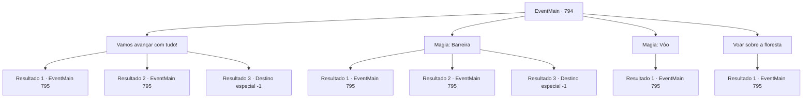

# Eventos principais · 794

[Índice da tabela](index.md) · [Índice geral](../index.md)

ID: `pt:EventMain:794` · Fonte: `EventMain4` · Versão: 1.2.47.

Mapeamento estático dos arquivos; a disponibilidade e a execução dependem do estado da run.

## Texto do evento

*Sem texto no arquivo.*

## Dados de entrada

```json
{
  "id": 794,
  "grade": 1,
  "normalGoal": "",
  "required": ""
}
```

## Mapa das escolhas



## Escolhas e resultados

### Escolha 1

Vamos avançar com tudo!

Requisitos e outros campos da escolha:

```json
{
  "required": ""
}
```

#### Resultado 1.1

Você decide atravessar a floresta. Valen assume a liderança ao cortar os arbustos. Cobras e insetos que perderam seus ninhos se apressam, mas perdem suas vidas para a espada dela. 

 "É veneno. Tenha cuidado."

 Como ela avisou, cobras e insetos carregam veneno. E o líquido roxo que se espalha pelo chão também é venenoso. O veneno não tem efeito sobre você. Logo em seguida, você sai da floresta negra e segue direto para a montanha de ossos. 

 Você para nas montanhas de ossos. Um demônio com um chifre gigante bloqueia você e Valen. O demônio segura uma espada e um chicote em chamas em uma mão. 

 "Balor. Estamos no caminho certo. Faça o seu melhor! {1}!"

 Com uma expressão de nervosismo, Valen puxa sua espada, e você está pronto com sua arma em mãos. Logo em seguida, Balor corre em sua direção e de Valen com um grito.

Continuação registrada: [Evento 795](0795.md) na mesma tabela.

```json
{
  "required": "",
  "chance": "1|0_13_1",
  "nextEvent": 795,
  "type": 0,
  "reward": "6_0_69",
  "place": 1
}
```

#### Resultado 1.2

Você decide atravessar a floresta. Valen assume a liderança ao cortar os arbustos. Cobras e insetos que perderam seus ninhos se apressam, mas perdem suas vidas para a espada dela. 

 "É veneno. Tenha cuidado."

 Como ela avisou, cobras e insetos carregam veneno. E o líquido roxo que se espalha pelo chão também é venenoso. Você começa a ter dor de cabeça. Parece que a toxicidade se espalhou pelo ar. Logo em seguida, você sai da floresta negra e segue direto para a montanha de ossos. 

 Você para nas montanhas de ossos. Um demônio com um chifre gigante bloqueia você e Valen. O demônio segura uma espada e um chicote em chamas em uma mão. 

 "Balor. Estamos no caminho certo. Faça o seu melhor! {1}!"

 Com uma expressão de nervosismo, Valen puxa sua espada, e você está pronto com sua arma em mãos. Logo em seguida, Balor corre em sua direção e de Valen com um grito.

Continuação registrada: [Evento 795](0795.md) na mesma tabela.

```json
{
  "required": "1_0_2",
  "chance": "18",
  "nextEvent": 795,
  "type": 1,
  "reward": "0_0_-1|6_0_69",
  "place": 1
}
```

#### Resultado 1.3

Você decide abrir caminho pela floresta. Valen assume a liderança ao cortar os arbustos. Cobras e insetos que perderam seus ninhos se apressam, mas perdem suas vidas para sua espada. 

 "É veneno. Tenha cuidado."

 Como ela avisou, cobras e insetos carregam veneno. E o líquido roxo que se espalha pelo chão também é venenoso. Você começa a ter uma dor de cabeça. Parece que a toxicidade se espalhou pelo ar. 

 "O que...! Ei!"

 De repente, o mundo inclina. Sua consciência é devorada pela escuridão.

Continuação registrada: [Destino especial `-1`](../destinos-especiais.md).

```json
{
  "required": "2_0_2",
  "chance": "18",
  "nextEvent": -1,
  "type": 1,
  "reward": "0_0_-1|15_5_1|15_5_19|15_5_28"
}
```

### Escolha 2

Magia: Barreira

Requisitos e outros campos da escolha:

```json
{
  "required": "20_0_2|1_1_2"
}
```

#### Resultado 2.1

Sensando perigo, você ativa a barreira e passa pela floresta. Valen assume a liderança cortando os arbustos. Cobras e insetos que perderam seus ninhos se apressam, mas perdem suas vidas para a espada dela. 

 "É veneno. Tenha cuidado."

 Como ela avisou, cobras e insetos carregam veneno. E o líquido roxo que se espalha pelo chão também é venenoso. Graças à sua barreira resistente, você passa com segurança pela floresta envenenada. Você segue direto para a montanha de ossos fora da floresta negra. 

 Você para nas montanhas de ossos. Um demônio com um chifre gigante bloqueia você e Valen. O demônio segura uma espada e um chicote em chamas em uma mão. 

 "Balor. Estamos no caminho certo. Faça o seu melhor! {1}!"

 Com uma expressão de nervosismo, Valen puxa sua espada, e você está pronto com sua arma em mãos. Logo em seguida, Balor corre em sua direção e de Valen com um grito.

Continuação registrada: [Evento 795](0795.md) na mesma tabela.

```json
{
  "required": "",
  "chance": "1|0_7_1|0_12_1",
  "nextEvent": 795,
  "type": 0,
  "reward": "6_0_69",
  "place": 1
}
```

#### Resultado 2.2

Sensando perigo, você ativa a barreira e passa pela floresta. Valen assume a liderança cortando os arbustos. Cobras e insetos que perderam seus ninhos se apressam, mas perdem suas vidas para a espada dela. 

 "É veneno. Tenha cuidado."

 Como ela avisou, cobras e insetos carregam veneno. E o líquido roxo que se espalha pelo chão também é venenoso. Talvez por causa disso, a barreira se quebra rapidamente. Você começa a ter dor de cabeça. Parece que a toxicidade se espalhou pelo ar. Logo em seguida, você sai da floresta negra e segue direto para a montanha de ossos. 

 Você para nas montanhas de ossos. Um demônio com um chifre gigante bloqueia você e Valen. O demônio segura uma espada e um chicote em chamas em uma mão. 

 "Balor. Estamos no caminho certo. Faça o seu melhor! {1}!"

 Com uma expressão de nervosismo, Valen puxa sua espada, e você está pronto com sua arma na mão. Logo em seguida, Balor corre em sua direção e de Valen com um grito.

Continuação registrada: [Evento 795](0795.md) na mesma tabela.

```json
{
  "required": "1_0_2",
  "chance": "18",
  "nextEvent": 795,
  "type": 1,
  "reward": "0_0_-1|6_0_69",
  "place": 1
}
```

#### Resultado 2.3

Sensando perigo, você ativa a barreira e passa pela floresta. Valen assume a liderança cortando os arbustos. Cobras e insetos que perderam seus ninhos se apressam, mas perdem suas vidas para sua espada. 

 "É veneno. Tenha cuidado."

 Como ela avisou, cobras e insetos carregam veneno. E o líquido roxo que se espalha pelo chão também é venenoso. Talvez por causa disso, a barreira se quebra rapidamente. Você começa a ter uma dor de cabeça. Parece que a toxicidade se espalhou pelo ar. 

 "O que...! Ei!"

 De repente, o mundo inclina. Sua consciência é devorada pela escuridão.

Continuação registrada: [Destino especial `-1`](../destinos-especiais.md).

```json
{
  "required": "2_0_2",
  "chance": "18",
  "nextEvent": -1,
  "type": 1,
  "reward": "0_0_-1|15_5_1|15_5_19|15_5_28"
}
```

### Escolha 3

Magia: Vôo 

Requisitos e outros campos da escolha:

```json
{
  "required": "20_0_4|1_1_2"
}
```

#### Resultado 3.1

Sensando o perigo, você segura a mão de Valen e tenta o Voo Terrestre. Você voa sobre a floresta com Valen. 

 Vocês param nas montanhas de ossos. Um demônio com um chifre gigante bloqueia você e Valen. O demônio segura uma espada e um chicote em chamas em uma mão. 

 "Balor. Vamos descer ao chão. É uma desvantagem aqui."

 Você desce apressadamente ao chão, seguido por Balor. E assim que você desce ao chão, o chicote de Balor voa.

Continuação registrada: [Evento 795](0795.md) na mesma tabela.

```json
{
  "required": "",
  "chance": "1",
  "nextEvent": 795,
  "type": 2,
  "reward": "6_0_69|0_1_-1",
  "place": 2
}
```

### Escolha 4

Voar sobre a floresta

Requisitos e outros campos da escolha:

```json
{
  "required": "20_10_1"
}
```

#### Resultado 4.1

O perigo da floresta negra não é um problema para você que pode voar no céu. Você estende a mão para Valen e a leva pelo céu e sobre a floresta. 

 Vocês param nas montanhas de ossos. Um demônio com um chifre gigante bloqueia você e Valen. O demônio segura uma espada e um chicote em chamas em uma mão. 

 "Balor. Vamos descer para o chão. É uma desvantagem aqui."

 Vocês descem rapidamente para o chão, seguidos por Balor. E assim que vocês chegam ao chão, o chicote de Balor voa.

Continuação registrada: [Evento 795](0795.md) na mesma tabela.

```json
{
  "required": "",
  "chance": "1",
  "nextEvent": 795,
  "type": 2,
  "reward": "6_0_69",
  "place": 2
}
```

## Referências que chegam a este evento

- [Evento 793 · escolha 1 · resultado 1](0793.md#escolha-1)
