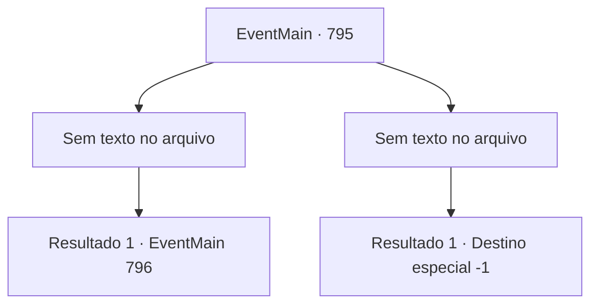

# Eventos principais · 795

[Índice da tabela](index.md) · [Índice geral](../index.md)

ID: `pt:EventMain:795` · Fonte: `EventMain4` · Versão: 1.2.47.

Mapeamento estático dos arquivos; a disponibilidade e a execução dependem do estado da run.

## Texto do evento

*Sem texto no arquivo.*

## Dados de entrada

```json
{
  "id": 795,
  "grade": 1,
  "normalGoal": "",
  "required": ""
}
```

## Mapa das escolhas



## Escolhas e resultados

### Escolha 1

*Sem texto no arquivo; o papel dessa opção depende da interface do jogo.*

Requisitos e outros campos da escolha:

```json
{
  "required": ""
}
```

#### Resultado 1.1

Balor balança um chicote em chamas. Com movimentos rápidos, Valen balança a espada como um relâmpago e corta o braço de Balor. Balor grita de dor, e você ataca o pescoço de Balor. O sangue do demônio é salpicado no chão carbonizado. O corpo de Balor, que perdeu a cabeça, desaba em seu lugar. Após matar Balor, você e Valen sobem a montanha de ossos. Era uma montanha de ossos, feita de inúmeros tipos de ossos. 

 A cada passo que você dá, poeira de ossos é espalhada. Após uma longa caminhada, você e Valen veem o portão principal do palácio e enfrentam os mortos em armaduras familiares. Eles são os Paladinos de Teretian. 

 "Valen... Irmã. Por que você nos matou?"

 Os olhos de Valen tremem quando ela os encara.
 A mão com a espada também treme violentamente.
 Seus lábios secos tremem.
 

 "Não... Eu... Eu..."


Continuação registrada: [Evento 796](0796.md) na mesma tabela.

```json
{
  "required": "",
  "chance": "1",
  "nextEvent": 796,
  "type": 2,
  "reward": ""
}
```

### Escolha 2

*Sem texto no arquivo; o papel dessa opção depende da interface do jogo.*

Requisitos e outros campos da escolha:

```json
{
  "required": ""
}
```

#### Resultado 2.1

O chicote flamejante de Balor balança em sua direção. Valen, que percebeu tarde demais, grita seu nome, mas é tarde demais. 

 "Cuidado! {1}!"

 Você não consegue evitar e acaba envolvido pelo chicote de Balor. E num instante, seu corpo é reduzido a cinzas.

Continuação registrada: [Destino especial `-1`](../destinos-especiais.md).

```json
{
  "required": "",
  "chance": "1",
  "nextEvent": -1,
  "type": 2,
  "reward": "0_0_-1|15_5_1|15_5_19|15_5_28"
}
```

## Referências que chegam a este evento

- [Evento 794 · escolha 1 · resultado 1](0794.md#escolha-1)
- [Evento 794 · escolha 1 · resultado 2](0794.md#escolha-1)
- [Evento 794 · escolha 2 · resultado 1](0794.md#escolha-2)
- [Evento 794 · escolha 2 · resultado 2](0794.md#escolha-2)
- [Evento 794 · escolha 3 · resultado 1](0794.md#escolha-3)
- [Evento 794 · escolha 4 · resultado 1](0794.md#escolha-4)
