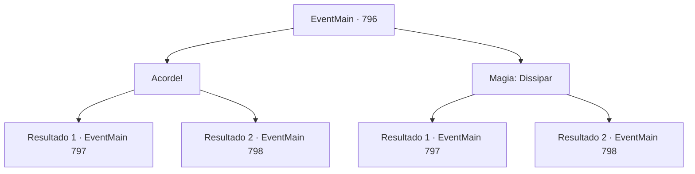

# Eventos principais · 796

[Índice da tabela](index.md) · [Índice geral](../index.md)

ID: `pt:EventMain:796` · Fonte: `EventMain4` · Versão: 1.2.47.

Mapeamento estático dos arquivos; a disponibilidade e a execução dependem do estado da run.

## Texto do evento

*Sem texto no arquivo.*

## Dados de entrada

```json
{
  "id": 796,
  "grade": 1,
  "normalGoal": "",
  "required": ""
}
```

## Mapa das escolhas



## Escolhas e resultados

### Escolha 1

Acorde!

Requisitos e outros campos da escolha:

```json
{
  "required": ""
}
```

#### Resultado 1.1

Você grita com Valen, e ela recupera o juízo. Ela pega a espada novamente, surpresa. 

 "Desculpe... Eu tenho agido feio."

 Quando ela está pronta para lutar, os demônios na imagem dos Paladinos revelam suas verdadeiras formas. Eles atacam você e Valen com garras afiadas e dentes.

Continuação registrada: [Evento 797](0797.md) na mesma tabela.

```json
{
  "required": "",
  "chance": "1|0_12_1",
  "nextEvent": 797,
  "type": 0,
  "reward": "6_2_154",
  "place": 2
}
```

#### Resultado 1.2

Você grita com Valen para que ela recupere os sentidos, mas ela parece não ouvir nada. 

 "Oh... Desculpe... Desculpe-me..."

 Finalmente, ela larga sua espada e cai. Os mortos avançam com suas armas como se estivessem em busca de vingança.

Continuação registrada: [Evento 798](0798.md) na mesma tabela.

```json
{
  "required": "",
  "chance": "16",
  "nextEvent": 798,
  "type": 1,
  "reward": "6_3_78",
  "place": 2
}
```

### Escolha 2

Magia: Dissipar

Requisitos e outros campos da escolha:

```json
{
  "required": "1_14_10|20_0_2|1_1_2"
}
```

#### Resultado 2.1

Você sente algo estranho e usa um dissipar para remover o seu disfarce. E então a identidade deles é revelada. Eles são todos tipos de demônios, atacando você e Valen com garras afiadas e dentes. Valen, que viu a verdadeira forma deles, ergue sua espada com os olhos bem abertos. O olhar assassino está em seus olhos.

Continuação registrada: [Evento 797](0797.md) na mesma tabela.

```json
{
  "required": "",
  "chance": "1|0_7_1|0_12_1",
  "nextEvent": 797,
  "type": 0,
  "reward": "6_2_154|0_1_-1",
  "place": 2
}
```

#### Resultado 2.2

Há algo estranho sobre os mortos na armadura do Paladino. Com olhos atentos, você percebe uma sobreposição de algo neles. Você lança dissipar, mas o feitiço falha. Você olha para trás para Valen, e ela já perdeu seu espírito de luta. 

 "Oh... Desculpe... Desculpe-me..."

 Ela finalmente larga sua espada e cai. Os mortos avançam com suas armas como se estivessem buscando vingança.

Continuação registrada: [Evento 798](0798.md) na mesma tabela.

```json
{
  "required": "",
  "chance": "10",
  "nextEvent": 798,
  "type": 1,
  "reward": "6_3_78|0_1_-1",
  "place": 2
}
```

## Referências que chegam a este evento

- [Evento 795 · escolha 1 · resultado 1](0795.md#escolha-1)
