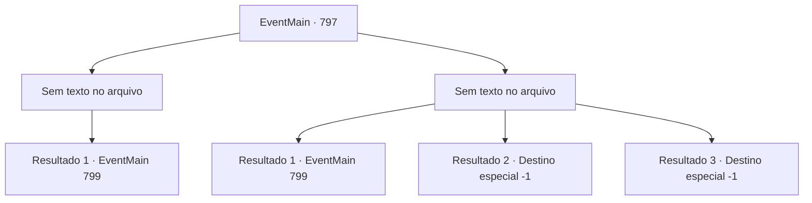

# Eventos principais · 797

[Índice da tabela](index.md) · [Índice geral](../index.md)

ID: `pt:EventMain:797` · Fonte: `EventMain4` · Versão: 1.2.47.

Mapeamento estático dos arquivos; a disponibilidade e a execução dependem do estado da run.

## Texto do evento

*Sem texto no arquivo.*

## Dados de entrada

```json
{
  "id": 797,
  "grade": 1,
  "normalGoal": "",
  "required": ""
}
```

## Mapa das escolhas



## Escolhas e resultados

### Escolha 1

*Sem texto no arquivo; o papel dessa opção depende da interface do jogo.*

Requisitos e outros campos da escolha:

```json
{
  "required": ""
}
```

#### Resultado 1.1

Você e Valen derrotam os demônios juntos. Valen sacode o sangue do demônio da espada e solta um suspiro áspero. 

 "...Vamos embora"

 Você abre o portão do palácio que os demônios estavam bloqueando. Ele é pelo menos cinco vezes maior e mais alto do que a Catedral de Teretian. Não apenas a largura e altura do prédio, mas tudo dentro dele é enorme. E no trono no final do salão está Kior. Ele é o mesmo que quando você o conheceu pela primeira vez, mas é enorme. Seus ossos da canela são mais altos do que você. Seus olhos vermelhos sangue olham para você e Valen. |drawing_sittingKior|

Continuação registrada: [Evento 799](0799.md) na mesma tabela.

```json
{
  "required": "",
  "chance": "1",
  "nextEvent": 799,
  "type": 2,
  "reward": ""
}
```

### Escolha 2

*Sem texto no arquivo; o papel dessa opção depende da interface do jogo.*

Requisitos e outros campos da escolha:

```json
{
  "required": ""
}
```

#### Resultado 2.1

Você sangra e cai no feroz ataque dos demônios. E então, a espada de Valen corta os demônios que te cercam. Ela te acorda no sangue dos demônios. Valen sacode o sangue dos demônios da espada e solta um suspiro áspero. 

 "...Vamos lá"

 Você abre o portão do palácio que os demônios estavam bloqueando. Ele é pelo menos cinco vezes maior e mais alto do que a Catedral de Teretian. Não apenas a largura e altura do prédio, mas tudo dentro dele é enorme. E no trono no final do salão está Kior. Ele é o mesmo que quando você o conheceu pela primeira vez, mas é enorme. Seus ossos da canela são mais altos do que você. Seus olhos vermelhos sangue olham para você e Valen. |drawing_sittingKior|

Continuação registrada: [Evento 799](0799.md) na mesma tabela.

```json
{
  "required": "1_0_2|1_1_2",
  "chance": "1",
  "nextEvent": 799,
  "type": 2,
  "reward": "0_0_-1|0_1_-1"
}
```

#### Resultado 2.2

Você sangra e cai no feroz ataque dos demônios. E imediatamente, as unhas e dentes do demônio voam e esculpem sua carne. Você perde a consciência em uma dor violenta que nunca experimentou antes.

Continuação registrada: [Destino especial `-1`](../destinos-especiais.md).

```json
{
  "required": "2_0_2",
  "chance": "1",
  "nextEvent": -1,
  "type": 2,
  "reward": "0_0_-1|0_1_-1|15_5_28|15_5_1|15_5_19"
}
```

#### Resultado 2.3

Você sangra e cai no feroz ataque dos demônios. E imediatamente, as unhas e dentes do demônio voam e esculpem sua carne. Você perde a consciência em uma dor violenta que nunca experimentou antes.

Continuação registrada: [Destino especial `-1`](../destinos-especiais.md).

```json
{
  "required": "2_1_2",
  "chance": "1",
  "nextEvent": -1,
  "type": 2,
  "reward": "0_0_-1|0_1_-1|15_5_28|15_5_1|15_5_19"
}
```

## Referências que chegam a este evento

- [Evento 796 · escolha 1 · resultado 1](0796.md#escolha-1)
- [Evento 796 · escolha 2 · resultado 1](0796.md#escolha-2)
