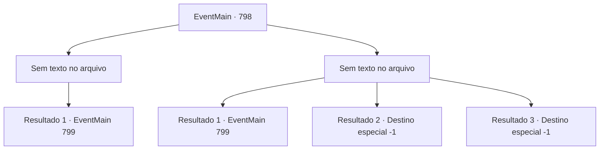

# Eventos principais · 798

[Índice da tabela](index.md) · [Índice geral](../index.md)

ID: `pt:EventMain:798` · Fonte: `EventMain4` · Versão: 1.2.47.

Mapeamento estático dos arquivos; a disponibilidade e a execução dependem do estado da run.

## Texto do evento

*Sem texto no arquivo.*

## Dados de entrada

```json
{
  "id": 798,
  "grade": 1,
  "normalGoal": "",
  "required": ""
}
```

## Mapa das escolhas



## Escolhas e resultados

### Escolha 1

*Sem texto no arquivo; o papel dessa opção depende da interface do jogo.*

Requisitos e outros campos da escolha:

```json
{
  "required": ""
}
```

#### Resultado 1.1

Você se livra de todos os fantasmas. Então os fantasmas caídos começam a distorcer, A magia que os envolvia é desfeita. Eles são na verdade demônios que compunham a imagem do paladino. Valen finalmente recupera o juízo quando vê o corpo do demônio. 

 "O que aconteceu?"

 Valen, que olha ao redor, se desculpa com você. 

 "...Desculpe. Eu te devo."

 Enquanto você recupera o fôlego, Valen abre a boca novamente. 

 "Se você voltar... Eu vou pagar essa dívida com certeza. Eu juro."

 Após um breve pedido de desculpas, ela toma a frente e abre a porta do palácio. Ele é pelo menos cinco vezes maior e mais alto do que a Catedral de Teretian. Não apenas a largura e altura do prédio, mas tudo dentro dele é enorme. E no trono no final do salão está Kior. Ele é o mesmo que quando você o conheceu pela primeira vez, mas ele é enorme. Seus ossos da canela são mais altos do que você. Seus olhos vermelho-sangue olham para você e Valen. |drawing_sittingKior|

Continuação registrada: [Evento 799](0799.md) na mesma tabela.

```json
{
  "required": "",
  "chance": "1",
  "nextEvent": 799,
  "type": 2,
  "reward": "5_435_1"
}
```

### Escolha 2

*Sem texto no arquivo; o papel dessa opção depende da interface do jogo.*

Requisitos e outros campos da escolha:

```json
{
  "required": ""
}
```

#### Resultado 2.1

Enquanto você está lutando contra fantasmas, a imagem dos fantasmas caídos se distorce e se transforma na imagem do demônio. Os encantamentos lançados sobre eles foram quebrados. Quando Valen vê isso, finalmente recobra o juízo, puxa sua espada e corta os demônios como um raio. Os demônios caem como folhas de outono e o ambiente fica silencioso. Valen sacode o sangue dos demônios da espada e se desculpa. 

 "... Desculpe. Eu te devo."

 Enquanto você recupera o fôlego, Valen abre a boca novamente. 

 "Se você voltar... Eu vou pagar essa dívida com certeza. Eu juro."

 Depois de um breve pedido de desculpas, ela toma a frente e abre a porta do palácio. É pelo menos cinco vezes maior e mais alto do que a Catedral de Teretian. Não apenas a largura e a altura do prédio, mas tudo dentro dele é enorme. E no trono no final do salão está Kior. Ele é o mesmo que quando você o conheceu pela primeira vez, mas é enorme. Seus ossos da canela são mais altos do que você. Seus olhos vermelhos sangue olham para você e Valen. |drawing_sittingKior|

Continuação registrada: [Evento 799](0799.md) na mesma tabela.

```json
{
  "required": "1_0_2|1_1_2",
  "chance": "1",
  "nextEvent": 799,
  "type": 2,
  "reward": "0_0_-1|0_1_-1|5_435_1"
}
```

#### Resultado 2.2

Você luta contra fantasmas e se machuca, mas consegue derrubar alguns deles. De repente, você cai com a cabeça no chão. Pus sangrento está vazando das feridas que você não sabe quando ocorreram, e a pele ao redor está podre e negra. A necrose negra se espalha rapidamente e tira sua vida.

Continuação registrada: [Destino especial `-1`](../destinos-especiais.md).

```json
{
  "required": "2_0_2",
  "chance": "1",
  "nextEvent": -1,
  "type": 2,
  "reward": "0_0_-1|0_1_-1|15_5_28|15_5_1|15_5_19"
}
```

#### Resultado 2.3

Você luta contra fantasmas e se machuca, mas consegue derrubar alguns deles. De repente, você cai com a cabeça no chão. Pus sangrento está vazando das feridas que você não sabe quando ocorreram, e a pele ao redor está podre e negra. A necrose negra se espalha rapidamente e tira sua vida.

Continuação registrada: [Destino especial `-1`](../destinos-especiais.md).

```json
{
  "required": "2_1_2",
  "chance": "1",
  "nextEvent": -1,
  "type": 2,
  "reward": "0_0_-1|0_1_-1|15_5_28|15_5_1|15_5_19"
}
```

## Referências que chegam a este evento

- [Evento 796 · escolha 1 · resultado 2](0796.md#escolha-1)
- [Evento 796 · escolha 2 · resultado 2](0796.md#escolha-2)
