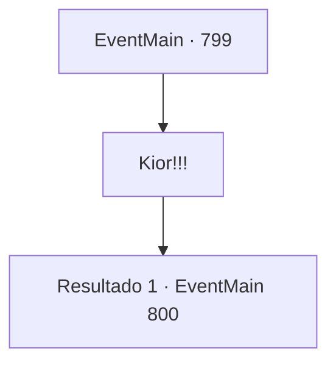

# Eventos principais · 799

[Índice da tabela](index.md) · [Índice geral](../index.md)

ID: `pt:EventMain:799` · Fonte: `EventMain4` · Versão: 1.2.47.

Mapeamento estático dos arquivos; a disponibilidade e a execução dependem do estado da run.

## Texto do evento

*Sem texto no arquivo.*

## Dados de entrada

```json
{
  "id": 799,
  "grade": 1,
  "normalGoal": "",
  "required": ""
}
```

## Mapa das escolhas



## Escolhas e resultados

### Escolha 1

Kior!!!

Requisitos e outros campos da escolha:

```json
{
  "required": ""
}
```

#### Resultado 1.1

Você corre em direção a Kior, gritando o nome dele. Mas Valen te agarra. Valen encara Kior com olhos gélidos. Então, Kior diz, acenando com uma taça de vinho em sua mão. 

 "Você chegou ao meu palácio, finalmente. Vou te elogiar."

 Sua voz baixa ecoa alto, mesmo em seu tom tranquilo. Com um sorriso leve, Kior diz para você. 

 "{1}. Vou fazer uma sugestão em apreciação aos seus esforços. Se você matar o servo de Tere agora e jurar lealdade a mim... Eu vou deixar você encontrar sua família."

 Você o encara em vez de responder. Kior joga uma taça de vinho para fora e pega a espada ao lado do trono. 

 "Ótimo. Eu vou lidar com você se você quiser morrer pelas minhas mãos. O cão louco deve ser dominado por cacetes."

 Uma espada gigante empunhada por Kior atinge você e Valen. Você escapa rapidamente do ataque e avança em direção a Kior.

Continuação registrada: [Evento 800](0800.md) na mesma tabela.

```json
{
  "required": "",
  "chance": "1",
  "nextEvent": 800,
  "type": 2,
  "reward": "6_0_155",
  "place": 7
}
```

## Referências que chegam a este evento

- [Evento 797 · escolha 1 · resultado 1](0797.md#escolha-1)
- [Evento 797 · escolha 2 · resultado 1](0797.md#escolha-2)
- [Evento 798 · escolha 1 · resultado 1](0798.md#escolha-1)
- [Evento 798 · escolha 2 · resultado 1](0798.md#escolha-2)
