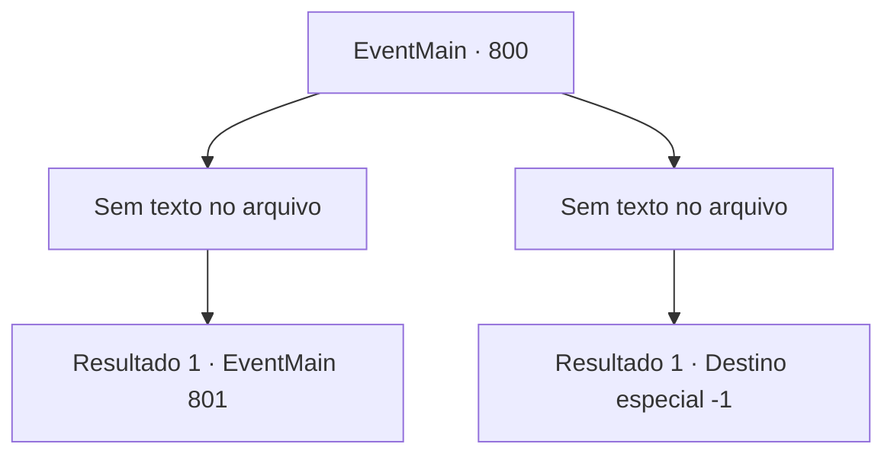

# Eventos principais · 800

[Índice da tabela](index.md) · [Índice geral](../index.md)

ID: `pt:EventMain:800` · Fonte: `EventMain4` · Versão: 1.2.47.

Mapeamento estático dos arquivos; a disponibilidade e a execução dependem do estado da run.

## Texto do evento

*Sem texto no arquivo.*

## Dados de entrada

```json
{
  "id": 800,
  "grade": 1,
  "normalGoal": "",
  "required": ""
}
```

## Mapa das escolhas



## Escolhas e resultados

### Escolha 1

*Sem texto no arquivo; o papel dessa opção depende da interface do jogo.*

Requisitos e outros campos da escolha:

```json
{
  "required": ""
}
```

#### Resultado 1.1

Valen se move rapidamente e chama a atenção de Kior. Você corta o braço direito de Kior sem perder a oportunidade que Valen criou. 

 "GRHEEAAA! Insignificante... mortal!"

 Kior, que perdeu seu braço direito, agarra a ferida e grita. Você olha para Kior e ajusta sua postura para dar um golpe final. Mas então. Inúmeros demônios aparecem na escuridão, bloqueando você e Valen. 

 "{1}! Não perca Kior!"

 Você ouve a voz urgente de Valen. Você olha nos olhos dela e percebe que um de vocês tem que lidar com os demônios.

Continuação registrada: [Evento 801](0801.md) na mesma tabela.

```json
{
  "required": "",
  "chance": "1",
  "nextEvent": 801,
  "type": 2,
  "reward": ""
}
```

### Escolha 2

*Sem texto no arquivo; o papel dessa opção depende da interface do jogo.*

Requisitos e outros campos da escolha:

```json
{
  "required": ""
}
```

#### Resultado 2.1

Seu corpo se parte ao meio com um som alto. Valen olha para você com o rosto rígido, e a risada de Kior é ouvida. 

 "Khaha! Não pense que isso acaba com a morte. {1}. A morte não pode te libertar da dor."

 Você fecha os olhos, vomitando sangue. Vem um sono profundo em que você não consegue pensar no significado das palavras de Kior.

Continuação registrada: [Destino especial `-1`](../destinos-especiais.md).

```json
{
  "required": "",
  "chance": "1",
  "nextEvent": -1,
  "type": 2,
  "reward": "0_0_-1|15_5_1|15_5_19|15_5_28"
}
```

## Referências que chegam a este evento

- [Evento 799 · escolha 1 · resultado 1](0799.md#escolha-1)
