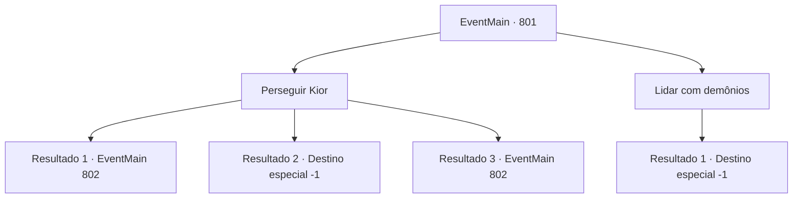

# Eventos principais · 801

[Índice da tabela](index.md) · [Índice geral](../index.md)

ID: `pt:EventMain:801` · Fonte: `EventMain4` · Versão: 1.2.47.

Mapeamento estático dos arquivos; a disponibilidade e a execução dependem do estado da run.

## Texto do evento

*Sem texto no arquivo.*

## Dados de entrada

```json
{
  "id": 801,
  "grade": 1,
  "normalGoal": "",
  "required": ""
}
```

## Mapa das escolhas



## Escolhas e resultados

### Escolha 1

Perseguir Kior

Requisitos e outros campos da escolha:

```json
{
  "required": ""
}
```

#### Resultado 1.1

Você deixa os demônios para Valen e persegue o Kior. Kior está fugindo para o fundo do palácio, segurando seu braço que está sangrando. A velocidade do Kior ferido está ficando cada vez mais lenta, então você o persegue logo atrás. Nesse exato momento. De repente, seus olhos se voltam para você, e uma ilusão familiar o abraça. A aparição de seu amado filho e cônjuge o impede de continuar andando, mesmo que seja uma ilusão. Eles o seguram em lágrimas, pedindo para que você não vá. Mas você aperta os dentes e ignora a ilusão. Você desfere um ataque final em Kior, encerrando o relacionamento errado. 

 "Eu... Eu...! Com um mero mortal!"

 Seu corpo se desfaz como cinzas e se dispersa ao vento. Você olha para ele ainda, e pensa em Valen. Quando você volta para ela, vê muitos demônios espalhados ao redor. Valen olha para você e pergunta o que aconteceu com Kior, Você responde a ela que matou Kior. 

 "Ufa... Que alívio. Você fez um ótimo trabalho. Vamos voltar agora"

 Valen dá tapinhas em seu ombro.

Continuação registrada: [Evento 802](0802.md) na mesma tabela.

```json
{
  "required": "24_7_1",
  "chance": "1|0_14_1",
  "nextEvent": 802,
  "type": 0,
  "reward": ""
}
```

#### Resultado 1.2

Você deixa os demônios para Valen e persegue o Kior. Kior está fugindo para o fundo do palácio, segurando seu braço que está sangrando. A velocidade do Kior ferido está ficando cada vez mais lenta, então você o persegue logo atrás. Nesse exato momento. De repente, seus olhos se voltam para você, e uma ilusão familiar o abraça. A aparição de seu amado filho e cônjuge o impede de andar, mesmo que seja uma ilusão. 

 "{1}!!"

 Você volta a si quando a ilusão desaparece na voz estrondosa de Valen. Logo depois, você olha ao redor rapidamente, mas não consegue encontrar um kior em lugar nenhum. 

 "... Nós devemos tê-lo perdido. Vamos persegui-lo imediatamente"

 Valen, que derrubou todos os demônios, olha para você e diz. Você suspira silenciosamente, então a segue e deixa o palácio de Kior. Não importa para onde ele tenha fugido, a vingança não vai parar até que ele morra. Você dá passos com essa determinação.

Continuação registrada: [Destino especial `-1`](../destinos-especiais.md).

```json
{
  "required": "24_7_1",
  "chance": "18",
  "nextEvent": -1,
  "type": 1,
  "reward": "15_5_9|15_5_19"
}
```

#### Resultado 1.3

Você deixa os demônios para Valen e persegue o Kior. Kior está fugindo para o fundo do palácio, segurando seu braço que está sangrando. A velocidade do Kior ferido está ficando cada vez mais lenta, então você o persegue logo atrás. Nesse exato momento. De repente, seus olhos se voltam para você, e uma ilusão familiar o abraça. A aparição de seu amado filho e cônjuge o impede de andar, mesmo que seja uma ilusão. Mas a ilusão desaparece porque não consegue superar sua resistência magia. Você desfere um ataque final em Kior, encerrando o relacionamento errado. 

 "Eu... Eu...! Para um mero mortal!"

 Seu corpo se desfaz como cinzas e se dispersa ao vento. Você olha para ele ainda, e pensa em Valen. Quando você volta para ela, vê muitos demônios espalhados ao redor. Valen olha para você e pergunta o que aconteceu com Kior, Você responde a ela que matou Kior. 

 "Ufa... Que alívio. Você fez um ótimo trabalho. Vamos voltar agora"

 Valen dá tapinhas em seu ombro.

Continuação registrada: [Evento 802](0802.md) na mesma tabela.

```json
{
  "required": "23_7_1",
  "chance": "1",
  "nextEvent": 802,
  "type": 2,
  "reward": ""
}
```

### Escolha 2

Lidar com demônios

Requisitos e outros campos da escolha:

```json
{
  "required": ""
}
```

#### Resultado 2.1

Você deixa o Kior para Valen e lida com os demônios. Muitos inimigos, desde o demônio desconhecido até o Hezrou, visam sua vida. Você espera por Valen contra o ataque deles.

 ".....{1}."

 Há quanto tempo os corpos dos demônios estão empilhados? E então Valen volta. 

 "Desculpe"

 Ela se desculpa por não ter matado Kior. Você a encara em branco por um momento. Não importa onde Kior esteja. Se Kior fugiu, você apenas o seguiria até o fim. Valen, que olha para suas costas sem dizer nada, segue com um passo cuidadoso.

Continuação registrada: [Destino especial `-1`](../destinos-especiais.md).

```json
{
  "required": "",
  "chance": "1",
  "nextEvent": -1,
  "type": 2,
  "reward": "15_5_9|15_5_19"
}
```

## Referências que chegam a este evento

- [Evento 800 · escolha 1 · resultado 1](0800.md#escolha-1)
