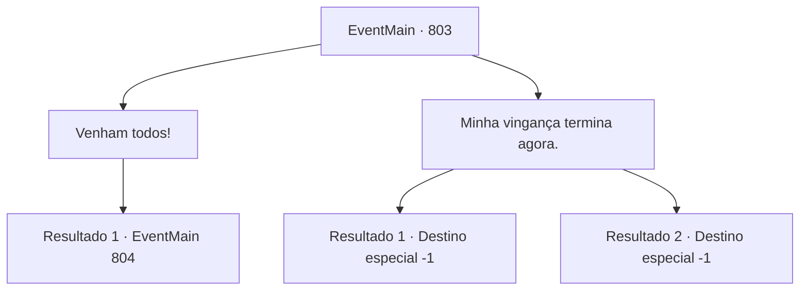

# Eventos principais · 803

[Índice da tabela](index.md) · [Índice geral](../index.md)

ID: `pt:EventMain:803` · Fonte: `EventMain4` · Versão: 1.2.47.

Mapeamento estático dos arquivos; a disponibilidade e a execução dependem do estado da run.

## Texto do evento

*Sem texto no arquivo.*

## Dados de entrada

```json
{
  "id": 803,
  "grade": 1,
  "normalGoal": "",
  "required": ""
}
```

## Mapa das escolhas



## Escolhas e resultados

### Escolha 1

Venham todos!

Requisitos e outros campos da escolha:

```json
{
  "required": ""
}
```

#### Resultado 1.1

Matou Kior, mas você não para de se vingar. Você levanta seu corpo. E grita para os Paladinos, 'Tragam tudo.' Porque o que essa ação significa é claro, até mesmo os Paladinos na cabine sacam suas armas. Com um rosto sério, Publius dá ordens. 

 "Todos. Capturem o pecador que fez um acordo com o demônio"

 Até Valen desembainha sua espada como se não pudesse evitar. Logo, os paladinos se lançam sobre você assim que Publius lança seu feitiço.

Continuação registrada: [Evento 804](0804.md) na mesma tabela.

```json
{
  "required": "",
  "chance": "1",
  "nextEvent": 804,
  "type": 2,
  "reward": "6_3_151",
  "place": 1
}
```

### Escolha 2

Minha vingança termina agora.

Requisitos e outros campos da escolha:

```json
{
  "required": ""
}
```

#### Resultado 2.1

Você balança a cabeça diante da pergunta, Publius. A morte da família começou com o esquema Kior. Os sacerdotes teretianos também foram responsáveis no processo, mas você decide encerrar sua vingança. 

 "...Eu entendo. Eu entendo"

 Publius abre caminho acenando com a cabeça com um rosto calmo. Você se despede deles e sai da cabine. Então, você ouve a voz de Publius. 

 "Quando se trata de assuntos familiares... Desculpe-me."

 Com essa voz, você pausa por um momento. E então você olha para trás. Publius abaixa a cabeça em sinal de desculpas. Você se vira e se afasta deles.

Continuação registrada: [Destino especial `-1`](../destinos-especiais.md).

```json
{
  "required": "18_435_1",
  "chance": "1",
  "nextEvent": -1,
  "type": 2,
  "reward": "15_5_0|15_5_20|15_5_29"
}
```

#### Resultado 2.2

Você balança a cabeça diante da pergunta, Publius. A morte da família começou com o esquema Kior. Os sacerdotes teretianos também foram responsáveis no processo, mas você decide encerrar sua vingança. 

 "...Eu entendo. Eu entendo"

 Publius abre caminho acenando com a cabeça com um rosto calmo. Você se despede deles e sai da cabine. Então, você ouve a voz de Publius. 

 "Quando se trata de assuntos familiares... Me desculpe."

 Com essa voz, você pausa por um momento. E então você olha para trás. Publius abaixa a cabeça em sinal de desculpas. Você se vira e se afasta deles. 

 Após uma dúzia de minutos, você olha para trás e vê alguém te seguindo. É Valen. Quando você a encara, ela abre a boca. 

 "Para pagar... a dívida."

 Você continua caminhando sem dizer uma palavra, Valen te segue a dois passos de distância.

Continuação registrada: [Destino especial `-1`](../destinos-especiais.md).

```json
{
  "required": "5_435_1",
  "chance": "1",
  "nextEvent": -1,
  "type": 2,
  "reward": "15_5_0|15_5_20|15_5_43"
}
```

## Referências que chegam a este evento

- [Evento 802 · escolha 1 · resultado 1](0802.md#escolha-1)
- [Evento 830 · escolha 2 · resultado 1](0830.md#escolha-2)
