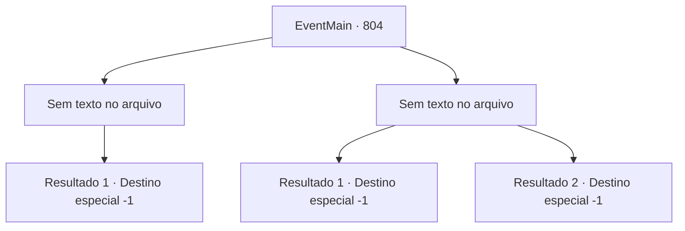

# Eventos principais · 804

[Índice da tabela](index.md) · [Índice geral](../index.md)

ID: `pt:EventMain:804` · Fonte: `EventMain4` · Versão: 1.2.47.

Mapeamento estático dos arquivos; a disponibilidade e a execução dependem do estado da run.

## Texto do evento

*Sem texto no arquivo.*

## Dados de entrada

```json
{
  "id": 804,
  "grade": 1,
  "normalGoal": "",
  "required": ""
}
```

## Mapa das escolhas



## Escolhas e resultados

### Escolha 1

*Sem texto no arquivo; o papel dessa opção depende da interface do jogo.*

Requisitos e outros campos da escolha:

```json
{
  "required": ""
}
```

#### Resultado 1.1

Você se aproxima de Publius caído segurando a espada de Valen. E levanta sua espada e grita para ele: 'Peça perdão à minha família.' Publius vomita sangue e grita. 

 "Olhe... olhe ao redor. Perdão... você precisa pedir perdão a Deus."

 Ao ouvir suas palavras, você olha lentamente ao redor. A cabana está uma bagunça com os corpos dos Paladinos. Entre os corpos estão Onil e Valen. Você se vira novamente para Publius e aponta a espada para o pescoço dele. Você diz novamente: 'Peça perdão.' 

 "Oh, Deus... Por favor... nós..."

 No entanto, Publius não atende ao seu pedido. Você não aguenta mais e corta a garganta dele. Você limpa o sangue das suas bochechas e joga a espada de Valen no chão. E então você sai cambaleando da cabana e começa a andar.

Continuação registrada: [Destino especial `-1`](../destinos-especiais.md).

```json
{
  "required": "",
  "chance": "1",
  "nextEvent": -1,
  "type": 2,
  "reward": "15_5_0|15_5_3|15_5_7"
}
```

### Escolha 2

*Sem texto no arquivo; o papel dessa opção depende da interface do jogo.*

Requisitos e outros campos da escolha:

```json
{
  "required": ""
}
```

#### Resultado 2.1

Quando a afiada espada de Valen toca seu pescoço, você admite a derrota. Sua vingança termina em fracasso, e o que resta de você é a morte. Você olha para Valen, pedindo para ela matar. Valen olha para você e lentamente puxa a espada.

 'Bam!'

 Você é chutado na mandíbula e cai no chão. A voz de Valen é ouvida através da consciência turva. 

 "{1}. Sua morte será feita por processo legal."

 Logo sua visão se torna completamente negra.

Continuação registrada: [Destino especial `-1`](../destinos-especiais.md).

```json
{
  "required": "18_435_1",
  "chance": "1",
  "nextEvent": -1,
  "type": 2,
  "reward": "0_0_-1|0_1_-1|15_5_6|15_5_20|15_5_29"
}
```

#### Resultado 2.2

Você está cada vez mais na defensiva. Seu corpo pode ter atingido seu limite, sua respiração está agitada e seus olhos embaçados. Então, o ataque dos paladinos para de repente. Porque Valen os impede. Todos que estão lá parecem envergonhados. Especialmente Publius. Ele pergunta a Valen, tremendo as mãos. 

 "O que você está fazendo?"

 Então Valen responde com voz trêmula. 

 "Arcebispo... Eu devo minha vida a {1}. Além disso, se não fosse por {1}, eu não seria capaz de me vingar dos meus colegas. Então... por favor, deixe-o ir. Eu te imploro."

 Enquanto Valen se ajoelha, Publius a agarra apressadamente. 

 "Levante-se! Vamos lá!"

 Mas ela é teimosa, e isso não acontece até que Publius finalmente prometa deixá-la ir. Os paladinos pegam suas armas e se retiram de você. E Publius fala com voz solene. 

 "... Nós vamos embora. Para dar crédito a você por matar Kior e atender ao pedido de Valen."

 No final disso, eles te deixam.

Continuação registrada: [Destino especial `-1`](../destinos-especiais.md).

```json
{
  "required": "5_435_1",
  "chance": "1",
  "nextEvent": -1,
  "type": 2,
  "reward": "0_0_-1|0_1_-1|15_5_0|15_5_20|15_5_43"
}
```

## Referências que chegam a este evento

- [Evento 803 · escolha 1 · resultado 1](0803.md#escolha-1)
