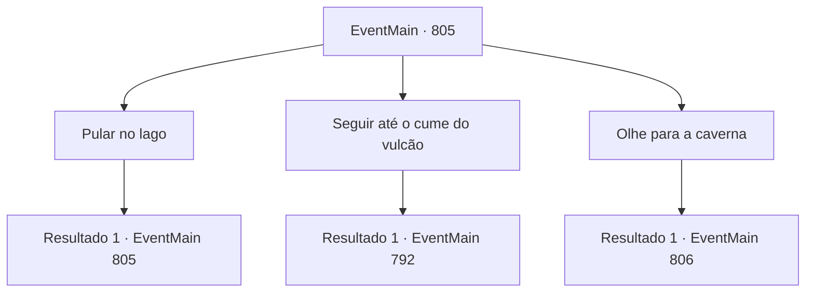

# Eventos principais · 805

[Índice da tabela](index.md) · [Índice geral](../index.md)

ID: `pt:EventMain:805` · Fonte: `EventMain4` · Versão: 1.2.47.

Mapeamento estático dos arquivos; a disponibilidade e a execução dependem do estado da run.

## Texto do evento

*Sem texto no arquivo.*

## Dados de entrada

```json
{
  "id": 805,
  "grade": 1,
  "normalGoal": "",
  "required": ""
}
```

## Mapa das escolhas



## Escolhas e resultados

### Escolha 1

Pular no lago

Requisitos e outros campos da escolha:

```json
{
  "required": "5_425_0"
}
```

#### Resultado 1.1

Você pula em um lago e encontra um passagem. O lago é profundo, mas claro e limpo, então é fácil olhar para o fundo. Mas não importa o quanto você olhe, você não vê o que pensa ser uma passagem. Eventualmente, você decide sair do lago e procurar em outro lugar.

Continuação registrada: [Evento 805](0805.md) na mesma tabela.

```json
{
  "required": "",
  "chance": "1",
  "nextEvent": 805,
  "type": 2,
  "reward": "5_425_1"
}
```

### Escolha 2

Seguir até o cume do vulcão

Requisitos e outros campos da escolha:

```json
{
  "required": ""
}
```

#### Resultado 2.1

Você vai para o topo do Monte Gracino novamente. Valen está se perguntando, mas ela segue seus passos imparáveis. Depois de chegar ao topo da montanha novamente, você olha para a cratera. Ainda há fumaça acre subindo e você pode sentir o cheiro de repugnância e amargura. 

 "Por que você voltou aqui?"

 Você joga uma pedra na cratera. Desta vez novamente, a aparência da lava não mudou nada. As pedras desapareceram como se estivessem passando pela lava.

Continuação registrada: [Evento 792](0792.md) na mesma tabela.

```json
{
  "required": "",
  "chance": "1",
  "nextEvent": 792,
  "type": 2,
  "reward": ""
}
```

### Escolha 3

Olhe para a caverna

Requisitos e outros campos da escolha:

```json
{
  "required": "5_426_0"
}
```

#### Resultado 3.1

 'Pusss--!'

 Um gêiser jorra e o chão treme um pouco. Você caminha ao redor da margem do lago e entra na caverna, seguido por Valen. É um lugar enorme e espaçoso, com muitos morcegos pendurados. Valen entra na caverna com uma expressão levemente irritada. 

 "Ei, este lugar é..."

 Nesse momento, os morcegos abrem os olhos ao ouvir sua voz e avançam em sua direção. Ondas de milhares de morcegos se lançam sobre você.

Continuação registrada: [Evento 806](0806.md) na mesma tabela.

```json
{
  "required": "",
  "chance": "1",
  "nextEvent": 806,
  "type": 2,
  "reward": "5_426_1|6_0_66",
  "place": 6
}
```

## Referências que chegam a este evento

- [Evento 792 · escolha 2 · resultado 1](0792.md#escolha-2)
- [Evento 805 · escolha 1 · resultado 1](0805.md#escolha-1)
- [Evento 806 · escolha 1 · resultado 2](0806.md#escolha-1)
- [Evento 806 · escolha 2 · resultado 2](0806.md#escolha-2)
