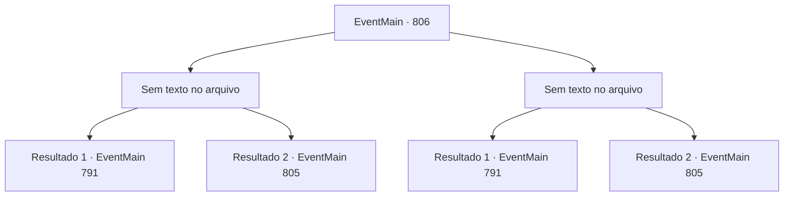

# Eventos principais · 806

[Índice da tabela](index.md) · [Índice geral](../index.md)

ID: `pt:EventMain:806` · Fonte: `EventMain4` · Versão: 1.2.47.

Mapeamento estático dos arquivos; a disponibilidade e a execução dependem do estado da run.

## Texto do evento

*Sem texto no arquivo.*

## Dados de entrada

```json
{
  "id": 806,
  "grade": 1,
  "normalGoal": "",
  "required": ""
}
```

## Mapa das escolhas



## Escolhas e resultados

### Escolha 1

*Sem texto no arquivo; o papel dessa opção depende da interface do jogo.*

Requisitos e outros campos da escolha:

```json
{
  "required": ""
}
```

#### Resultado 1.1


 "... Encontre outro lugar."

 Você extermina os morcegos vampiros com Valen e escapa da caverna.

Continuação registrada: [Evento 791](0791.md) na mesma tabela.

```json
{
  "required": "18_427_1",
  "chance": "1",
  "nextEvent": 791,
  "type": 2,
  "reward": ""
}
```

#### Resultado 1.2


 "... Encontre outro lugar."

 Você extermina os morcegos vampiros com Valen e escapa da caverna.

Continuação registrada: [Evento 805](0805.md) na mesma tabela.

```json
{
  "required": "5_427_1",
  "chance": "1",
  "nextEvent": 805,
  "type": 2,
  "reward": ""
}
```

### Escolha 2

*Sem texto no arquivo; o papel dessa opção depende da interface do jogo.*

Requisitos e outros campos da escolha:

```json
{
  "required": ""
}
```

#### Resultado 2.1

Quando você é atacado por um enxame de morcegos vampiros, Valen vem correndo e empunha sua espada. Num instante, os morcegos vampiros são eliminados, e ela franze a testa e olha para você. 

 "...Encontre o corredor"

 Você assente com a cabeça e corre para fora da caverna.

Continuação registrada: [Evento 791](0791.md) na mesma tabela.

```json
{
  "required": "18_427_1",
  "chance": "1",
  "nextEvent": 791,
  "type": 2,
  "reward": ""
}
```

#### Resultado 2.2

Quando você é atacado por um enxame de morcegos vampiros, Valen vem correndo e empunha sua espada. Num instante, os morcegos vampiros são eliminados, e ela franze a testa e olha para você. 

 "...Encontre o corredor"

 Você assente com a cabeça e corre para fora da caverna.

Continuação registrada: [Evento 805](0805.md) na mesma tabela.

```json
{
  "required": "5_427_1",
  "chance": "1",
  "nextEvent": 805,
  "type": 2,
  "reward": ""
}
```

## Referências que chegam a este evento

- [Evento 791 · escolha 3 · resultado 1](0791.md#escolha-3)
- [Evento 805 · escolha 3 · resultado 1](0805.md#escolha-3)
