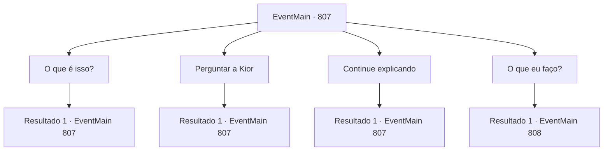

# Eventos principais · 807

[Índice da tabela](index.md) · [Índice geral](../index.md)

ID: `pt:EventMain:807` · Fonte: `EventMain4` · Versão: 1.2.47.

Mapeamento estático dos arquivos; a disponibilidade e a execução dependem do estado da run.

## Texto do evento

De manhã, ao acordar, você ouviu a voz de Kior. 

 "O dia mencionado por Publius está quase chegando. Comece a se dirigir à catedral."

 Com Kior te apressando, você se apressou e seguiu rumo à catedral de Yerut. |drawing_tereCathedral| Dias depois, ao chegar à catedral de Yerut, você viu vários cavaleiros de Tere. Eles estavam ocupados se preparando para algo, usando armaduras com o símbolo de Tere. Você subiu as escadas na entrada da catedral, quando uma mulher o segurou. Era Danica. Ela sorriu e, com uma voz suave, disse: 

 "Quanto tempo! {1}. Podemos conversar um pouco?"


## Dados de entrada

```json
{
  "id": 807,
  "grade": 1,
  "normalGoal": "",
  "required": "1_2_100|13_4_22"
}
```

## Mapa das escolhas



## Escolhas e resultados

### Escolha 1

O que é isso?

Requisitos e outros campos da escolha:

```json
{
  "required": "5_428_0"
}
```

#### Resultado 1.1

Danica responde à sua pergunta olhando ao redor. 

 "Aqui não é bom... Há uma estalagem nas proximidades, então conversaremos lá."

 Danica agarra seu pulso e desce as escadas sem ouvir sua resposta. Você a segue até a estalagem.

 A estalagem é um alojamento de luxo perto da catedral. O quarto de Danica tem aproximadamente o mesmo tamanho da casa da sua cidade natal e possui uma cama limpa. Você se senta na cama e pergunta sobre seus negócios. Então Danica olha para você e responde naturalmente. <color=red>

 "É bom ter um camarada que compartilha a vontade de Kior."

</color>

Continuação registrada: [Evento 807](0807.md) na mesma tabela.

```json
{
  "required": "",
  "chance": "1",
  "nextEvent": 807,
  "type": 2,
  "reward": "5_428_1"
}
```

### Escolha 2

Perguntar a Kior

Requisitos e outros campos da escolha:

```json
{
  "required": "5_428_1"
}
```

#### Resultado 2.1


 "Apenas como Danica disse. Ela era minha comparsa. Quero dizer... Isso começou cerca de 3 meses atrás."

 Três meses atrás foi quando você a salvou dos adoradores. Em outras palavras, Danica já estava sendo manipulada por Kior desde então. Você pisca e olha para ela, e Danica começa a explicar com uma voz calma. 

 "Então, vou explicar primeiro o plano de Teretian."

 Danica tira um livro antigo e mostra para você. Ao abrir uma página específica, você vê o círculo mágico com muitas runas. 

 "Teretian está tentando trazer Kior para o mundo material através desse círculo mágico na catedral. Eles se prepararam intensamente para isso durante 3 meses."


Continuação registrada: [Evento 807](0807.md) na mesma tabela.

```json
{
  "required": "",
  "chance": "1",
  "nextEvent": 807,
  "type": 2,
  "reward": "5_428_2"
}
```

### Escolha 3

Continue explicando

Requisitos e outros campos da escolha:

```json
{
  "required": "5_428_2"
}
```

#### Resultado 3.1

Como você pediu, Danica continuou a explicar. 

 "Se você adicionar poder mágico a este círculo mágico, um caminho se conectará do mundo material ao inferno. Mas se você modificar alguns desses textos..."

 Os dedos de Danica apontam passo a passo para algumas das runas no livro. 

 "Será capaz de convocá-los para onde Kior está. E se houver uma luta, a vitória ou derrota é clara."

 Ela ri confiante de que Kior vencerá.

Continuação registrada: [Evento 807](0807.md) na mesma tabela.

```json
{
  "required": "",
  "chance": "1",
  "nextEvent": 807,
  "type": 2,
  "reward": "5_428_3"
}
```

### Escolha 4

O que eu faço?

Requisitos e outros campos da escolha:

```json
{
  "required": "5_428_3"
}
```

#### Resultado 4.1

Quando você pergunta o que você tem que fazer, Danica para de rir e responde. 

 "O círculo mágico está na praça atrás da catedral. Já está completo, mas o círculo mágico começará amanhã."

 Ela explica como 'Modificar' o círculo mágico. 

 "Seria bom se um de nós chamasse a atenção do guarda e o resto entrasse e modificasse o círculo mágico..."

 Danica pergunta sua opinião sobre qual papel você quer.

Continuação registrada: [Evento 808](0808.md) na mesma tabela.

```json
{
  "required": "",
  "chance": "1",
  "nextEvent": 808,
  "type": 2,
  "reward": "5_428_4"
}
```

## Referências que chegam a este evento

- [Evento 807 · escolha 1 · resultado 1](0807.md#escolha-1)
- [Evento 807 · escolha 2 · resultado 1](0807.md#escolha-2)
- [Evento 807 · escolha 3 · resultado 1](0807.md#escolha-3)
