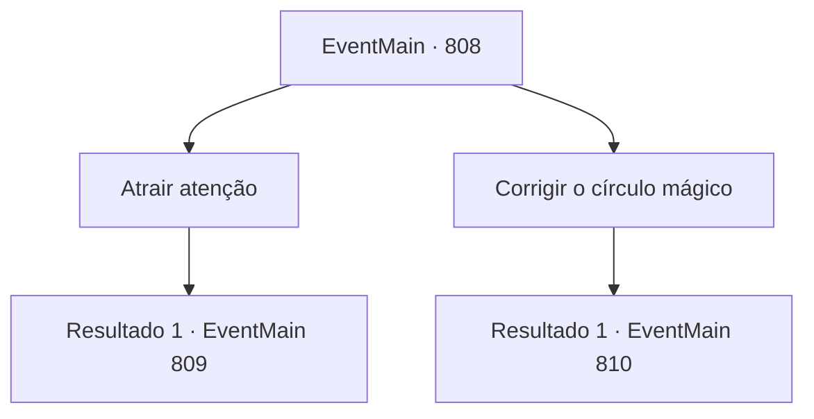

# Eventos principais · 808

[Índice da tabela](index.md) · [Índice geral](../index.md)

ID: `pt:EventMain:808` · Fonte: `EventMain4` · Versão: 1.2.47.

Mapeamento estático dos arquivos; a disponibilidade e a execução dependem do estado da run.

## Texto do evento

*Sem texto no arquivo.*

## Dados de entrada

```json
{
  "id": 808,
  "grade": 1,
  "normalGoal": "",
  "required": ""
}
```

## Mapa das escolhas



## Escolhas e resultados

### Escolha 1

Atrair atenção

Requisitos e outros campos da escolha:

```json
{
  "required": ""
}
```

#### Resultado 1.1

Como resultado de uma breve discussão, você decide chamar a atenção do guarda. Danica sai da estalagem para contar a Publius que você chegou.

 Tarde da noite, você caminha pelo corredor da catedral com Danica. Enquanto você caminha pelo corredor feito de mármore branco, você vê a praça atrás da catedral. Danica se esconde e pede para você arrastar um pouco mais de tempo. Você acena com a cabeça e olha para a entrada da praça. Dois paladinos estão firmes com suas lanças.

Continuação registrada: [Evento 809](0809.md) na mesma tabela.

```json
{
  "required": "",
  "chance": "1",
  "nextEvent": 809,
  "type": 2,
  "reward": ""
}
```

### Escolha 2

Corrigir o círculo mágico

Requisitos e outros campos da escolha:

```json
{
  "required": ""
}
```

#### Resultado 2.1

Como resultado de uma breve discussão, você decide modificar o círculo mágico. Danica sai da estalagem para contar a Publius que você chegou.

 Tarde da noite, você caminha pelo corredor da catedral com Danica. Enquanto você caminha pelo corredor feito de mármore branco, você vê a praça atrás da catedral. Assim que você se esconde, Danica se aproxima dos dois Paladinos de guarda. 

 "Com licença... Vocês podem me ajudar? Preciso mover minhas coisas, mas está muito pesado. Só vai levar um momento."

 Com as palavras de Danica, os dois Paladinos hesitam e a seguem. Após confirmar que eles foram embora completamente, você entra rapidamente na praça. E verifica o círculo mágico. Há um círculo mágico com muitas runas sob a luz da lua.

Continuação registrada: [Evento 810](0810.md) na mesma tabela.

```json
{
  "required": "",
  "chance": "1",
  "nextEvent": 810,
  "type": 2,
  "reward": ""
}
```

## Referências que chegam a este evento

- [Evento 807 · escolha 4 · resultado 1](0807.md#escolha-4)
