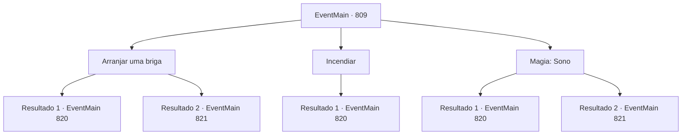

# Eventos principais · 809

[Índice da tabela](index.md) · [Índice geral](../index.md)

ID: `pt:EventMain:809` · Fonte: `EventMain4` · Versão: 1.2.47.

Mapeamento estático dos arquivos; a disponibilidade e a execução dependem do estado da run.

## Texto do evento

*Sem texto no arquivo.*

## Dados de entrada

```json
{
  "id": 809,
  "grade": 1,
  "normalGoal": "",
  "required": ""
}
```

## Mapa das escolhas



## Escolhas e resultados

### Escolha 1

Arranjar uma briga

Requisitos e outros campos da escolha:

```json
{
  "required": ""
}
```

#### Resultado 1.1

Você caminha orgulhosamente até a praça. Então os Paladinos bloqueiam o caminho, e você franze o rosto e começa uma briga com eles. Uma discussão menor rapidamente se transforma em uma briga física. Como se estivesse com raiva, você o agarrou pela gola, dizendo: 'Vamos resolver isso lá fora.' Eles podem ter sentido o limite da paciência, e ambos os paladinos te seguem. Enquanto isso, você continua agindo como se vê Danica entrando secretamente na praça. E você acaba sendo espancado por eles e se esconde, fingindo fugir.

Continuação registrada: [Evento 820](0820.md) na mesma tabela.

```json
{
  "required": "",
  "chance": "1|0_12_1",
  "nextEvent": 820,
  "type": 0,
  "reward": ""
}
```

#### Resultado 1.2

Você caminha orgulhosamente até a praça. Então os Paladinos bloqueiam o caminho, e você franze o rosto e começa uma briga com eles. Uma discussão menor rapidamente se transforma em uma briga física. Como se estivesse com raiva, você o agarrou pela gola, dizendo: 'Vamos resolver isso lá fora.' Eles podem ter sentido o limite da paciência, e um dos paladinos te segue. Mas o outro ainda está guardando a entrada. Você deixa o resto para Danica e se esconde, fingindo fugir do Paladino.

Continuação registrada: [Evento 821](0821.md) na mesma tabela.

```json
{
  "required": "",
  "chance": "16",
  "nextEvent": 821,
  "type": 1,
  "reward": ""
}
```

### Escolha 2

Incendiar

Requisitos e outros campos da escolha:

```json
{
  "required": "23_3_1"
}
```

#### Resultado 2.1

Você acende um fogo no canto da catedral. O fogo no tapete se espalha rapidamente e começa a queimar uma sala inteira. 

 "Fogo! Fogo!"

 À medida que a fumaça repentina se espalha, os paladinos que guardam a praça saem correndo. Você se esconde ao observar Danica entrando na praça secretamente.

Continuação registrada: [Evento 820](0820.md) na mesma tabela.

```json
{
  "required": "",
  "chance": "1",
  "nextEvent": 820,
  "type": 2,
  "reward": "25_3_1"
}
```

### Escolha 3

Magia: Sono

Requisitos e outros campos da escolha:

```json
{
  "required": "20_0_1|1_1_2"
}
```

#### Resultado 3.1

Você cobre seu corpo secretamente e tenta conjurar o sono. Com poder mágico, eles adormecem e eventualmente caem no sono. Depois de vê-los dormindo, você olha para Danica. Ela acena para você e caminha silenciosamente até a praça.

Continuação registrada: [Evento 820](0820.md) na mesma tabela.

```json
{
  "required": "",
  "chance": "1|0_7_1|0_12_1",
  "nextEvent": 820,
  "type": 0,
  "reward": "0_1_-1"
}
```

#### Resultado 3.2

Eles adormecem por causa do poder mágico, Logo eles voltam a si e gritam. 

 "O quê? Como você se atreve a fazer magia? Pode haver intrusos, então se apresse e avise-os!"

 Eles se dispersam em direções diferentes. Danica, vá para a praça; depois de vê-la, esconda-se por enquanto.

Continuação registrada: [Evento 821](0821.md) na mesma tabela.

```json
{
  "required": "",
  "chance": "16",
  "nextEvent": 821,
  "type": 1,
  "reward": "0_1_-1"
}
```

## Referências que chegam a este evento

- [Evento 808 · escolha 1 · resultado 1](0808.md#escolha-1)
