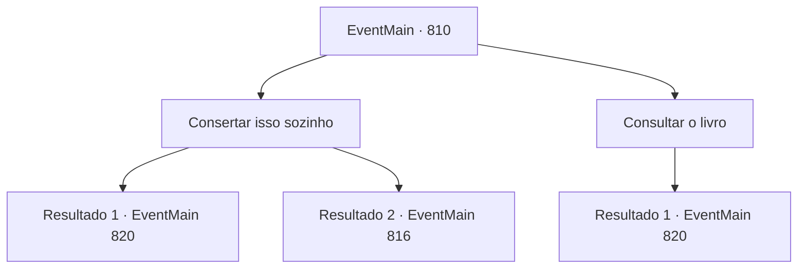

# Eventos principais · 810

[Índice da tabela](index.md) · [Índice geral](../index.md)

ID: `pt:EventMain:810` · Fonte: `EventMain4` · Versão: 1.2.47.

Mapeamento estático dos arquivos; a disponibilidade e a execução dependem do estado da run.

## Texto do evento

*Sem texto no arquivo.*

## Dados de entrada

```json
{
  "id": 810,
  "grade": 1,
  "normalGoal": "",
  "required": ""
}
```

## Mapa das escolhas



## Escolhas e resultados

### Escolha 1

Consertar isso sozinho

Requisitos e outros campos da escolha:

```json
{
  "required": ""
}
```

#### Resultado 1.1

Você modifica rapidamente o círculo mágico, lembrando-se do que ouviu de Danica. Há um total de oito runas que precisam ser modificadas. A letra para luz é alterada para escuridão, a letra para invocação é alterada para espaço, e a letra para Deus é alterada para Demônio. E você sai secretamente do local depois de modificar rapidamente outros caracteres. Logo em seguida, os passos dos paladinos que retornam ressoam na catedral.

Continuação registrada: [Evento 820](0820.md) na mesma tabela.

```json
{
  "required": "",
  "chance": "1|0_14_1",
  "nextEvent": 820,
  "type": 0,
  "reward": ""
}
```

#### Resultado 1.2

Você modifica rapidamente o círculo mágico, lembrando-se do que ouviu de Danica. Há um total de oito runas que precisam ser modificadas. A letra para luz é trocada por escuridão, a letra para invocação é trocada por espaço, e a letra para Deus é trocada por Demônio. E você modifica rapidamente outros textos e se levanta. Nesse exato momento, você ouve uma voz irritada atrás de você. 

 "Quem mandou você tocar no círculo mágico?"

 Você saca sua arma e olha para trás. Escamas douradas e olhos rasgados verticalmente. Onil, o inimigo da família e o paladino dos Lizardfolk, vem até você, segurando o pescoço de uma Danica desmaiada. Logo em seguida, Onil joga Danica no chão e corre em sua direção.

Continuação registrada: [Evento 816](0816.md) na mesma tabela.

```json
{
  "required": "",
  "chance": "16",
  "nextEvent": 816,
  "type": 1,
  "reward": "6_0_145",
  "place": 10
}
```

### Escolha 2

Consultar o livro

Requisitos e outros campos da escolha:

```json
{
  "required": "8_53_1"
}
```

#### Resultado 2.1

Você modifica rapidamente o círculo mágico referindo-se ao princípio da magia. Há um total de oito runas que precisam ser modificadas. A letra para luz é alterada para escuridão, a letra para invocação é alterada para espaço, e a letra para Deus é alterada para Demônio. E você sai secretamente do local depois de modificar rapidamente outros caracteres. Logo em seguida, os passos dos paladinos que retornam ressoam na catedral.

Continuação registrada: [Evento 820](0820.md) na mesma tabela.

```json
{
  "required": "",
  "chance": "1",
  "nextEvent": 820,
  "type": 2,
  "reward": ""
}
```

## Referências que chegam a este evento

- [Evento 808 · escolha 2 · resultado 1](0808.md#escolha-2)
